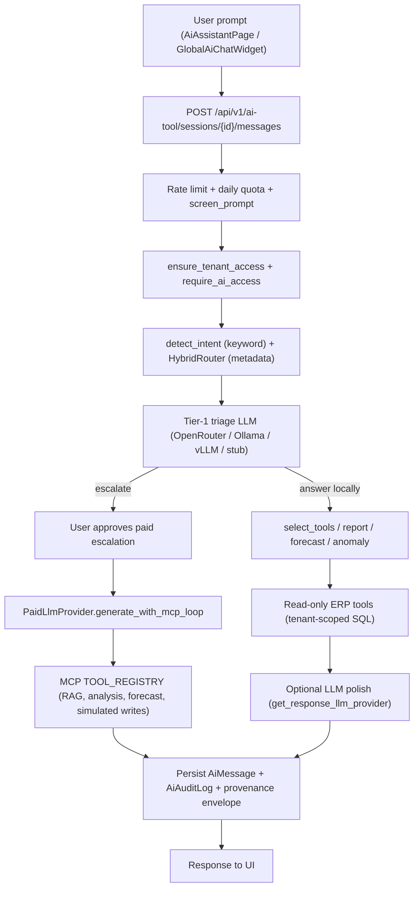
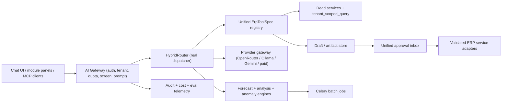

# 01 - Existing AI Architecture Audit

Part of the Prime7 AI strategy set. Index: [`AI_DEVELOPMENT_MASTER_PLAN.md`](AI_DEVELOPMENT_MASTER_PLAN.md).

**Audit date:** 2026-11-04
**Method:** Read-only code inspection of `backend/app/modules/ai_tool/`, `ai_extract/`, `mcp_server/`, `erp_ai_phases/`, `backend/app/models/ai_*.py`, `backend/app/workers/`, `backend/app/config.py`, `docker-compose*.yml`, and Alembic. Existing docs were compared last and treated as claims, not truth.

**Labels used in this document**

| Label | Meaning |
|---|---|
| Verified | Confirmed by reading the code at the cited path |
| Inferred | Reasonable conclusion from code, not executed |
| Runtime-verify | Depends on live config, data, or running services; must be checked on a running stack |

---

## 1. Summary

Prime7 has a **real, mature AI orchestration layer**, not a prototype. It includes multi-provider LLM routing, tenant-scoped chat persistence, a read-only ERP tool registry, hybrid vector + keyword retrieval (pgvector), deterministic forecasting adapters, rule-based anomaly detection, document extraction, and an approval/audit scaffold.

The main limitations are:

1. **AI cannot actually commit ERP transactions.** The MCP "write" tools return simulations (`backend/app/modules/mcp_server/erp_backend.py`, `status: "SIMULATION"`). (Verified)
2. **Background AI work is not real yet.** The Celery AI tasks are placeholders (`backend/app/workers/forecast_worker.py:run_forecast_placeholder`, `backend/app/workers/task_worker.py`). Forecasts run synchronously in the request. (Verified)
3. **Two parallel tool systems and two approval flows** exist and overlap. (Verified)
4. **Documentation lags the code.** For example, `docs/AI_TOOL_IMPLEMENTATION_STATUS.md` says rate limiting is "not yet enforced", but `backend/app/modules/ai_tool/router.py` applies `rate_limit_dependency` and `enforce_ai_daily_tenant_quota`. (Verified)

---

## 2. Actual request flow (chat assistant)

Main orchestrator: `backend/app/modules/ai_tool/service.py:process_prompt` (about 800+ lines). Paid escalation: `service.py:approve_escalation`. (Verified)

---

## 3. Component-by-component inventory

### 3.1 LLM providers and model selection

| Provider | Path : symbol | Wired? | Role |
|---|---|---|---|
| OpenRouter | `llm_provider/openrouter_provider.py:OpenRouterLlmProvider`; client `llm_provider/openrouter_client.py:openrouter_chat_completion` | Yes (preferred by default) | Tier-1 triage and response polish |
| Ollama | `llm_provider/ollama_provider.py:OllamaLlmProvider` (holds `TRIAGE_SYSTEM_PROMPT`) | Yes | Local tier-1 (`/api/generate`, `stream: False`) |
| vLLM | `llm_provider/vllm_provider.py:VllmLlmProvider` | Yes, but only if enabled | OpenAI-compatible local server |
| Stub | `llm_provider/stub_provider.py:StubLlmProvider` | Yes (last resort) | No external call |
| Paid tier-2 | `llm_provider/paid_provider.py:PaidLlmProvider` via `get_paid_llm_provider()` | Yes | OpenRouter / OpenAI / Anthropic with MCP tool loop (max 6 iterations, 60s httpx timeout) |
| Gemini wrapper (ai_tool) | `llm_provider/gemini_provider.py:GeminiLlmProvider` | **No - orphan** | Never imported by `get_llm_provider` |
| Gemini shared client | `backend/app/common/gemini_client.py:generate_text_for_tenant` | Yes | Tenant narrative features (dashboard brief, weekly report, planning). OpenRouter first, Gemini fallback |

**Selection order** in `llm_provider/__init__.py:get_llm_provider` (Verified):

1. OpenRouter, if `openrouter_tier1_preferred` is true and it is configured
2. Ollama, if enabled and a URL is set
3. OpenRouter, if configured
4. vLLM, if enabled with URL and model
5. Stub

**Router engine** (`backend/app/modules/ai_tool/router_engine/`): `hybrid_router.py:HybridRouter.route` returns a `RouteDecision` with cost and latency estimates; `route_registry.py:INTENT_PRIMARY_ROUTE`; `escalation.py:complexity_score`. In practice the router mostly **adds audit metadata**. The real execution path is decided by the keyword intent classifier (`intents.py:detect_intent`) and tier-1 triage. (Verified)

Which provider actually answers on production depends on live `.env` keys. (Runtime-verify)

### 3.2 Prompts, sanitisation, guardrails

| Concern | Path : symbol |
|---|---|
| Tier-1 system prompt | `llm_provider/ollama_provider.py:TRIAGE_SYSTEM_PROMPT` (reused by vLLM and prepended for OpenRouter) |
| Tenant context line | `tenant_ai_context.py:build_tenant_system_prompt_line` |
| PII redaction for external providers | `llm_provider/prompt_sanitizer.py:redact_pii_for_external_provider` (email, phone, card regex; self-described "best-effort") |
| Length clamp | `prompt_sanitizer.py:clamp_text_for_llm` |
| Injection / abuse screen | `guardrails.py:screen_prompt` (4000-char max, regex denylist) |
| User prompt presets | `models/ai_tool.py:AiSavedPrompt` |

There is **no central prompt template store**. System prompts are inline strings in `ollama_provider.py`, `service.py`, and `paid_provider.py`. (Verified)

### 3.3 Tool / function calling

Two separate registries exist (Verified):

**A. Internal chat tools** - `tool_registry.py:REGISTRY`, `select_tools`, `ToolDefinition`

- Handlers in `tools/`: `dashboard_tools`, `approvals_tools`, `orders_tools`, `inventory_tools`, `production_tools`, `vendors_tools`, `finance_tools`, `bom_tools`, `purchase_tools`, `calendar_tools`
- Plus `search_unstructured_context` and `analyze_structured_metrics`
- All `safety_class="READ_ONLY"` except `calendar_manage` (`DRAFT_ONLY`). No `COMMIT_REQUIRED` tool exists in this registry.

**B. MCP / paid tools** - `backend/app/modules/mcp_server/tools.py:TOOL_REGISTRY`

| Tool | Safety class | Backend behaviour |
|---|---|---|
| `create_sales_inquiry` | COMMIT_REQUIRED | `erp_backend.create_sales_inquiry` returns `SIMULATION` |
| `create_financial_voucher` | COMMIT_REQUIRED | Simulation (preview only) |
| `process_goods_receipt` | COMMIT_REQUIRED | Simulation (preview only) |
| `search_unstructured_context` | READ_ONLY | Real hybrid RAG |
| `analyze_structured_metrics` | READ_ONLY | Real pandas pipelines |
| `generate_forecast` | DRAFT_ONLY | `forecast/job_manager.run_forecast_for_mcp` |
| `create_system_task` | Dynamic | DB task + inline executor |

Authorisation for both: `authz.py` (`ensure_tenant_access`, `can_use_ai_module`, `has_tool_permission`, `require_ai_access`) and `policy_eval.py` (`evaluate_ai_policy`, `evaluate_ai_safety_for_user`) using `AiPermissionPolicy` rows and tenant `feature_flags` (`ai_enabled`, `ai_modules_enabled`, `ai_max_safety_class`).

### 3.4 MCP server

| Piece | Path : symbol | Behaviour |
|---|---|---|
| Mount | `mcp_server/__init__.py:mount_mcp` | Skipped unless `mcp_enabled` (default `False` in `config.py`) |
| Auth | `mcp_server/auth.py:McpAuthMiddleware`, `resolve_mcp_tenant` | Staff JWT + optional `X-Tenant-Id`; `mcp_require_auth` default `True` |
| Tenant guard | `mcp_server/tenant_guard.py:validate_tenant` | Tool `tenant_id` must equal context tenant; if context is `None`, only checks it is a positive integer |
| Commit gate | `mcp_server/safety.py:check_commit_allowed` | Requires human approval fields or `mcp_commit_bypass` (default `False`) |
| In-process bridge | `call_registered_tool`, `get_registered_tools` | Used by `PaidLlmProvider` without HTTP |

### 3.5 Embeddings, vector database, RAG

| Piece | Path : symbol |
|---|---|
| Embedding model | `retrieval/embeddings.py:get_embedding_model` - `all-MiniLM-L6-v2`, 384 dimensions, CPU, loaded in the API process |
| Vector table | `models/ai_tool.py:AiEmbeddingChunk.embedding = Vector(384)`, unique per tenant/source/chunk |
| Migrations | `alembic/versions/125_pgvector_ai_embedding_chunks.py` (IVFFlat), `128_..._search_tsv.py` (GIN full-text) |
| Vector search | `retrieval/adapters.py:PgVectorRetrievalAdapter` |
| Keyword (BM25-style) | `retrieval/bm25_adapter.py:BM25EmbeddingChunksAdapter` |
| Fusion | `retrieval/fusion.py:reciprocal_rank_fusion`, `merge_hybrid_hits`, `freshness_multiplier` |
| Orchestrator | `retrieval/unstructured_search.py:search_unstructured_context` |
| Ingestion | `retrieval/ingestion.py`, `retrieval/source_registry.py` (order remarks, styles, follow-ups, knowledge docs; `.limit(500)` per fetch), `retrieval/index_manager.py:reindex_stale` |
| Separate keyword KB | `AiKnowledgeDocument` / `AiKnowledgeChunk` via `SqlKeywordRetrievalAdapter` |

Whether embeddings are actually populated for each tenant is unknown. (Runtime-verify)

### 3.6 Conversation memory

`AiSession`, `AiMessage` (with token columns and `content_json` holding intent, tools, provenance), `AiToolInvocation`, `AiFeedback`. CRUD in `repository.py`. There is no long-term semantic memory of past chats. (Verified)

### 3.7 Orchestration and background work

| Area | Status |
|---|---|
| Synchronous chat orchestration | Wired (`service.py:process_prompt`) |
| System tasks | `tasks/executor.py:TASK_HANDLERS` mostly echo/ping handlers |
| Task policies | `tasks/policies.py:classify_task`, `APPROVAL_GATED_TYPES`; `tasks/policy_engine.py:evaluate_task_creation_policy` |
| Dead letter | `tasks/dead_letter.py:record_dead_letter` + `AiSystemTaskDeadLetter` |
| Approval artifacts | `artifacts/service.py:commit_artifact` (calls the simulation backend) |
| Automation | `automation.py:propose_action`, `confirm_and_execute_action` (draft rules; one real write - a draft `Followup`) |
| Celery AI tasks | Placeholders (`forecast_worker.py`, `task_worker.py`) |
| Beat schedule | Weekly AI reports via `backend/app/common/celery_app.py` when beat is enabled; in-process schedulers when `INPROCESS_SCHEDULERS_ENABLED=true` (default) |

### 3.8 AI database tables

From `backend/app/models/ai_tool.py` (Verified): `ai_sessions`, `ai_messages`, `ai_tool_invocations`, `ai_audit_logs`, `ai_saved_prompts`, `ai_report_runs`, `ai_forecast_runs`, `ai_forecast_models`, `ai_knowledge_documents`, `ai_knowledge_chunks`, `ai_embedding_chunks`, `ai_automation_rules`, `ai_action_runs`, `ai_system_tasks`, `ai_system_task_dead_letters`, `ai_approval_artifacts`, `ai_permission_policies`, `ai_task_policies`, `ai_ingestion_jobs`, `ai_feedback`, `ai_weekly_reports`, `ai_anomaly_events`.

Also: `models/ai_controlled_action.py`, and per-module suggestion tables `customer_ai_suggestion.py`, `inquiry_ai_suggestion.py`, `order_ai_suggestion.py`, `quotation_ai_suggestion.py`, `vendor_ai_suggestion.py`.

### 3.9 Observability, tokens, cost

| Mechanism | Reality |
|---|---|
| `tracing.py:RequestTracer` | Latency spans saved in assistant `content_json.trace_spans` |
| `audit.py:log_ai_event` | Lifecycle events with token, latency, route, tool and `cost_estimate_usd` columns |
| Cost in USD | **Column exists, never populated** - no caller passes `cost_estimate_usd=` (Verified by search) |
| OpenRouter logs | `openrouter_chat_completion` / `openrouter_request_failed` log tokens and latency |
| Tenant budget | `generate_text_for_tenant` records usage; `AI_MONTHLY_BUDGET_LIMIT`, `AI_MAX_REQUESTS_PER_TENANT_PER_DAY`, `AI_MAX_TOKENS_PER_REQUEST` in config |
| Provenance | `provenance.py:build_response_envelope` (confidence, grounding, citations) |

### 3.10 Errors, retries, timeouts

- Tool loop: `guardrails.py:call_with_timeout` plus an in-memory circuit breaker (`should_block_circuit`, `record_circuit_failure`)
- OpenRouter: `backend/app/common/httpx_openrouter_retry.py:post_chat_completions_with_429_retry` (up to 5 attempts)
- Forecast: `asyncio.wait_for` with `forecast_sync_timeout_seconds`
- System tasks: exponential backoff then dead letter
- Tier-1 triage exceptions are swallowed and the request continues without triage

### 3.11 Module-local AI outside `ai_tool`

| Module | Path |
|---|---|
| Document extraction | `backend/app/modules/ai_extract/` (Gemini multimodal provider; stub in tests) |
| ERP AI phases (copilot, governance, document AI, rule evaluator) | `backend/app/modules/erp_ai_phases/` |
| Production planning AI | `production/gemini_planning_service.py`, `production/planning_router.py`, `production/efficiency_ai_service.py` |
| Production heuristics | `production/predictive_heuristic_service.py` |
| CRM AI (inquiry, order, customer, quotation, vendor) | `*_ai_router.py` / `*_ai_service.py` / `*_ai_authz.py` in their modules |
| Dashboard brief | `dashboard/ai_services.py` |
| Financier confidence narrative | `external_access/financier_portal/ai_confidence_service.py` (template, no LLM) |

---

## 4. Wired versus incomplete

| Component | Verdict |
|---|---|
| Sessions, messages, chat orchestration | Wired |
| Intent detection + read-only ERP tools | Wired |
| Rate limits and daily quota on AI routes | Wired |
| Tier-1 OpenRouter / Ollama / vLLM | Wired (config dependent) |
| Tier-2 paid + MCP tool loop | Wired (config dependent) |
| MCP HTTP mount | Optional, off by default |
| MCP ERP writes | **Simulation only** |
| `GeminiLlmProvider` in ai_tool | **Orphan** |
| `HybridRouter` as real dispatcher | Partial (metadata) |
| pgvector hybrid RAG | Wired (needs ingested embeddings) |
| Forecast heuristics | Wired, synchronous only |
| Celery AI workers | **Placeholders** |
| System task domain handlers | Mostly stubs |
| Cost USD telemetry | **Schema only** |

---

## 5. Architectural weaknesses

| # | Weakness | Evidence | Impact |
|---|---|---|---|
| W1 | Two tool registries with overlapping names | `ai_tool/tool_registry.py:REGISTRY` vs `mcp_server/tools.py:TOOL_REGISTRY` | Duplicate maintenance; paid tier cannot call internal ERP read tools directly |
| W2 | Router decides little | `HybridRouter` output is mostly logged; `detect_intent` keyword rules dominate | Brittle natural-language routing |
| W3 | UI implies actions that never happen | `erp_backend.py` returns `[SIMULATION]` | User confusion; false sense of automation |
| W4 | Per-process rate limiter and circuit breaker | `guardrails.py:_rate_buckets`, `_breaker_state` are module dicts | Limits multiply with each worker/replica |
| W5 | Embedding model runs inside the API process | `retrieval/embeddings.py` lazy singleton (sentence-transformers on CPU) | RAM and latency spikes under concurrent RAG |
| W6 | Long jobs run in the request | Celery placeholders | Timeouts on large tenants |
| W7 | Gemini split | Chat uses OpenRouter/Ollama; narratives use `gemini_client`; extraction forced to Gemini; `GeminiLlmProvider` unused | Three provider paths to configure and debug |
| W8 | No cost metering | `cost_estimate_usd` never set | No per-tenant cost visibility |
| W9 | Latent tenant default | `paid_provider.py:PaidLlmProvider.generate` passes `tenant_id=1` | Any future caller would run tools as tenant 1 (see doc 07) |
| W10 | Ingestion caps | `source_registry.py` `.limit(500)` | Large tenants get partial semantic coverage |

---

## 6. Proposed improved architecture (summary)

The full target design is in [04-agentic-erp-architecture.md](04-agentic-erp-architecture.md) and [06-infrastructure-and-cost.md](06-infrastructure-and-cost.md). The changes in brief:

1. **One tool registry** (`ErpToolSpec`) shared by chat and MCP, with `safety_class`, `autonomy_max`, `permission_key`, and an `erp_service` pointer to an existing validated service function.
2. **Make `HybridRouter` the real dispatcher**, with the keyword intent classifier as a fast pre-filter.
3. **Move shared state to Redis** (rate limits, circuit breaker), reusing the existing `backend/app/common/redis_client.py:get_redis`.
4. **Run heavy AI work on Celery** (embeddings reindex, forecasts, weekly reports) using `backend/app/workers/async_runner.py:run_async`.
5. **One provider gateway** (`get_llm_provider` plus `generate_text_for_tenant` merged behind one interface); delete or wire the orphan Gemini wrapper.
6. **Populate cost telemetry** from provider usage responses.
7. **Replace MCP simulations with service adapters** only after the approval path is unified.

