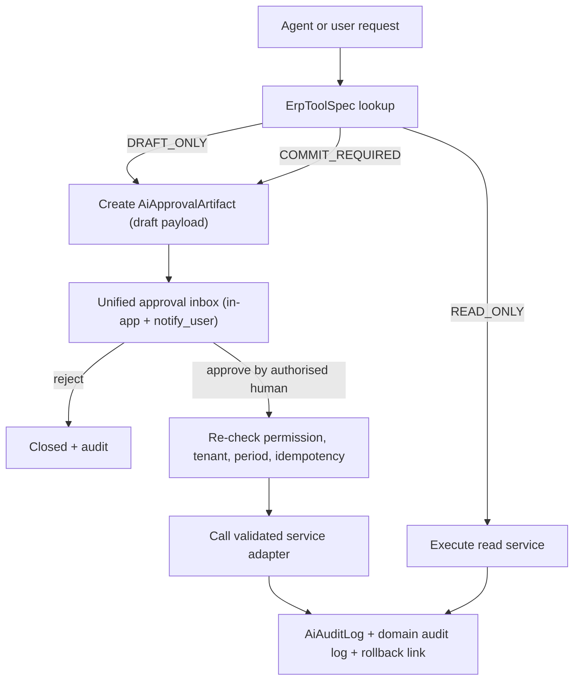

# 04 - Agentic ERP Architecture

Part of the Prime7 AI strategy set. Index: [`AI_DEVELOPMENT_MASTER_PLAN.md`](../../AI_DEVELOPMENT_MASTER_PLAN.md).

**Audit date:** 2026-11-04
**Core rule:** AI agents never write directly to the database and never bypass ERP permissions, validation, approvals or accounting controls. Every AI action that changes data must go through the same service function a human user would trigger, after a human approves it where required.

---

## 1. Where Prime7 stands today

| Level | Meaning | Today | Evidence |
|---|---|---|---|
| L1 Read and explain | Answer questions from ERP data | **Exists** | `ai_tool/tool_registry.py:REGISTRY` (read-only tools), `dashboard/ai_services.py`, `ai_tool/weekly_report_service.py`, `ai_extract` |
| L2 Analyse and recommend | Scores, anomalies, suggestions | **Exists** | `ai_tool/anomaly.py:generate_anomaly_insights`, `analysis/pipelines/*`, `bom_tools.suggest_*`, `purchase_tools.suggest_*` |
| L3 Prepare drafts | Proposed transactions for a human to confirm | **Partial** | `automation.py:propose_action` / `confirm_and_execute_action` (drafts; only real write is a draft `Followup`); `calendar_manage` proposals; artifacts with `pending_review` |
| L4 Execute approved actions via validated services | After approval, call real ERP services | **Not built** | `mcp_server/erp_backend.py` returns `[SIMULATION]`; `artifacts/service.py:commit_artifact` calls those simulations |
| L5 Narrow pre-authorised automation | Scheduled/rule-triggered, audited, with escalation | **Scaffold only** | `tasks/policies.py:APPROVAL_GATED_TYPES`, `tasks/policy_engine.py`, `tasks/dead_letter.py`; `tasks/executor.py:TASK_HANDLERS` are echo/ping only |

### 1.1 Can AI write to the database today? (Verified)

| Path | Writes? | Guard |
|---|---|---|
| Chat tools (`ai_tool/tools/*`) | No - SELECT only | `READ_ONLY` safety class; `calendar_manage_tool` returns proposed rows with `requires_ui_confirmation` |
| Analysis SQL | No - read only | `analysis/safe_query.py:tenant_scoped_query` runs fixed templates that must contain `:tenant_id`; **the LLM never writes SQL** |
| Copilot intents | No | `erp_ai_phases/copilot_service.py:run_safe_copilot_intent` - allowlisted count queries |
| Automation confirm | **Yes, one path** | `automation.py:confirm_and_execute_action` creates a `Followup` after a hashed confirmation token; restricted keywords block approve/post/payroll |
| MCP commit tools | No - simulation | `mcp_server/safety.py:check_commit_allowed` + simulation backend |
| System tasks | No - placeholders | Gated types listed in `tasks/policies.py:APPROVAL_GATED_TYPES` (`bulk_finance_post`, `inventory_auto_po`, `merch_bulk_commit`, `payroll_commit`, `production_order_release`, `commit_*`) |

This is a **safe starting position**. The work ahead is to raise capability without losing it.

### 1.2 Three overlapping approval mechanisms

1. **Automation confirmation token** - `automation.py` + UI `AiActionProposeCard.tsx`, `AiActionRunsTable.tsx`, `AiRulesCatalogCard.tsx`
2. **Governance proposals inbox** - `erp_ai_phases/governance_service.py` + UI `AiGovernanceInbox.tsx` (admin approve/reject/rollback; comment in code says no auto-execution)
3. **Approval artifacts** - `ai_tool/artifacts/service.py` + `AiApprovalArtifact` table

These should become **one approval path** (section 4).

---

## 2. Target capability map

| Capability | Level | Built on | Status |
|---|---|---|---|
| Conversational ERP Q&A | L1 | Chat + read tools | Exists; widen tool coverage |
| Natural-language to safe query | L1 | Template catalogue + `tenant_scoped_query`; LLM picks template and fills typed parameters | Partial (keyword intents) |
| AI-generated dashboards/reports | L1-L2 | `reporting.py` templates; LLM explains deterministic numbers | Exists |
| Proactive anomaly detection | L2 | `anomaly.py`, merch `RULE_REGISTRY`, Celery schedule | Exists on demand; schedule it |
| Management alerts | L2 + L5 notify-only | `notifications/service.py:notify_user` | Generic in-app; unify |
| Workflow monitoring agents | L2 | Control tower + TNA + approvals tools | Partial |
| Document reading and extraction | L1 -> L3 | `ai_extract` produces form drafts | Exists (fills forms; never auto-saves) |
| Approval recommendation agents | L2 | Read approvals + policy checks; recommend, never approve | New |
| Procurement recommendation agents | L2 -> L3 | Reorder + MRP + supplier scorecard -> draft PO | New (draft) |
| Financial monitoring agents | L2 | Exposure ladder, party aging, voucher anomalies | Partial |
| Production monitoring agents | L2 | Hourly + completion forecast + heuristics | Partial |
| Executive daily briefing | L1 | `dashboard/executive_ai_brief_service.py`, weekly report | Exists; make daily and deterministic-first |

---

## 3. Permission-aware ERP tool registry

### 3.1 Design

One registry entry wraps **one existing service or router function**. Never raw SQL writes. Chat (`ai_tool/tool_registry.py`) and MCP (`mcp_server/tools.py`) both read from it.

```python
# Proposed shape - extends the existing ToolDefinition in ai_tool/tool_registry.py
@dataclass(frozen=True)
class ErpToolSpec:
    name: str                       # "inventory.draft_purchase_order"
    module: str                     # "inventory"
    handler: Callable[..., Awaitable[ToolResult]]
    input_model: type[BaseModel]    # Pydantic schema; the LLM must fill this, nothing else
    permission_key: str             # existing RBAC key, e.g. "ai.tools.inventory.read"
    domain_permission_key: str | None  # e.g. "inventory.over_receipt_approve"
    safety_class: SafetyClass       # READ_ONLY | DRAFT_ONLY | COMMIT_REQUIRED
    autonomy_max: int               # 1..5 ceiling; tenant policy may lower it
    erp_service: str | None         # import path of the validated service it calls
    requires_artifact: bool         # COMMIT_REQUIRED tools must go through approval
    idempotency_fields: tuple[str, ...]
    audit_resource: str
    sensitive: bool                 # finance, payroll, LC -> extra redaction + approval
```

### 3.2 Reuse map

| Already exists | Extend with |
|---|---|
| `ToolDefinition` + `SafetyClass` (`tool_registry.py`) | `autonomy_max`, `erp_service`, `input_model`, `sensitive` |
| `policy_eval.py:evaluate_ai_safety_for_user` | Enforce `autonomy_max` against tenant flag `ai_max_safety_class` |
| `AiPermissionPolicy` table | Per-tool deny / maximum safety class per tenant |
| `authz.py:has_tool_permission` | Also check `domain_permission_key` via existing `assert_delegate_manager_or_permission` |
| Artifacts + governance proposals + automation tokens | Merge into one approval inbox (section 4) |
| `mcp_server/safety.py:check_commit_allowed` | Keep; replace simulation backends with adapters only after section 4 is done |

### 3.3 Service adapters (new, later phase)

Much create/update/post logic lives in routers rather than service modules. Before L4, extract the validated logic into callable services and wrap them:

```
backend/app/modules/ai_tool/adapters/
    __init__.py
    inventory_adapter.py   # wraps create_purchase_order (draft), create_goods_receiving (draft)
    merch_adapter.py       # wraps create_bom_from_order, create_po_from_line (draft)
    crm_adapter.py         # wraps create_customer / create inquiry draft
    finance_adapter.py     # wraps create_voucher in DRAFT status only - never post
```

Each adapter must call the same checks as the HTTP route: tenant ownership (`app/common/ownership.py:ensure_owned`), permissions, open accounting period, and status rules. It must also follow the project rule of `await safe_async_session_rollback(db)` on any caught DB error.

---

## 4. One approval path



Rules:

- The approver must hold the **domain permission**, not just AI access.
- Approval re-runs validation at commit time (data may have changed).
- Low-risk drafts (note, reminder, follow-up) can keep the quick confirmation token, but write the same artifact row so everything is in one audit trail.
- Every committed action links to its artifact so it can be reversed through the normal ERP reversal flow (for example a reversing voucher), never by deleting rows.

---

## 5. Autonomy levels per ERP action

| ERP action | Max level | Notes |
|---|---|---|
| Answer questions, list records, explain KPIs | L1 | Already exists |
| Risk scores, anomalies, recommendations | L2 | Already exists for many modules |
| Draft inquiry / customer / follow-up / note | L3 -> L4 | Low risk; candidate for first real adapter |
| Draft purchase order from reorder or MRP suggestion | L3 -> L4 | Human approves; uses existing reorder `approve_suggestion` flow |
| Draft BOM from similar style | L3 | Merch approves, freezes manually |
| Create voucher **draft** | L3 -> L4 (draft only) | Never posts |
| **Post voucher, release payment run** | **L3 only (prepare)**; posting stays a human action | Financial posting |
| **Open, amend or utilise BTB / export LC** | **L3 only** | LC commitment |
| **Payroll finalise / approve / post; salary changes** | **L3 only** | Already in `APPROVAL_GATED_TYPES` (`payroll_commit`) |
| Stock adjustment / physical count post / over-receipt | L3; L4 only with governance permission keys | `inventory.over_receipt_approve` etc. |
| Order cancel, commercial lock break | L3 | Admin only |
| Send in-app alert / notification | L5 (notify-only) | Rate limited, de-duplicated, audited |
| Scheduled anomaly scan, weekly report, reindex | L5 | Background; read-only side effects |

**Permanent rule:** financial postings, LC commitments, and salary or payroll changes are never executed autonomously. AI may prepare them; an authorised human executes them in the normal ERP screen.

---

## 6. Natural language to safe queries

Do **not** let the LLM write SQL. Instead:

1. Keep a catalogue of named, parameterised query templates (the existing pipelines in `analysis/pipelines/*` are the start).
2. The LLM chooses a template name and fills a Pydantic parameter model (date range, customer id, status).
3. Parameters are validated; related ids are checked with `ensure_owned`.
4. The template runs through `tenant_scoped_query`, which refuses templates without `:tenant_id`.
5. The LLM receives the result table and writes an explanation. Numbers shown to users come from the table, not from the LLM text.

---

## 7. Agents to build (in order)

| Agent | Level | Trigger | Output |
|---|---|---|---|
| Daily executive briefing | L1 | Celery beat, 07:00 tenant time | Deterministic KPI block + short LLM summary |
| Order risk monitor | L2 + L5 notify | Nightly | Risk list, alerts to merchandiser |
| Material shortage monitor | L2 + L5 notify | Nightly | Shortages vs production start |
| BTB maturity monitor | L2 + L5 notify | Daily | Maturities not covered by projected cash |
| Procurement recommender | L3 | On demand / nightly | Draft PO artifacts for approval |
| Approval recommender | L2 | When approval opens | "Looks normal / check X" note; never approves |

Rollback for every agent: tenant feature flag off, or lower `ai_max_safety_class` to `READ_ONLY`.
