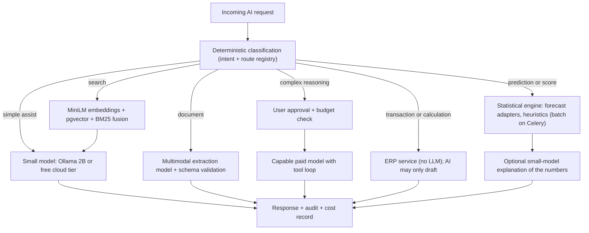

# 06 - AI Infrastructure, Performance and Cost

Part of the Prime7 AI strategy set. Index: [`AI_DEVELOPMENT_MASTER_PLAN.md`](../../AI_DEVELOPMENT_MASTER_PLAN.md).

**Audit date:** 2026-11-04
**Rule followed:** nothing is assumed to be deployed unless it appears in `docker-compose.yml`, `docker-compose.prod.yml`, `backend/app/config.py` or `backend/requirements.txt`. Live `.env` values were **not** read; which keys are set in production is Runtime-verify.

---

## 1. What is actually configured

| Layer | Evidence | Status |
|---|---|---|
| PostgreSQL + pgvector | `pgvector/pgvector:pg16` in both compose files; `Vector(384)` in `models/ai_tool.py` | Configured |
| PgBouncer | `edoburu/pgbouncer` in `docker-compose.yml` | Configured (local) |
| Redis | `redis:7-alpine` in both compose files; `REDIS_URL` | Configured |
| Celery worker + beat | `worker` and `beat` services in both compose files; broker and results on Redis | Configured; AI tasks are placeholders |
| FastAPI API | `docker-compose.prod.yml` runs `uvicorn app.main:app --workers 2` | Configured - **2 processes** |
| Ollama (local small model) | `ollama` + `ollama-init` services pull `gemma2:2b-instruct-q4_K_M` (both compose files) | Service defined; whether the model finished pulling is Runtime-verify (`docker compose exec ollama ollama list`) |
| vLLM | `VLLM_ENABLED=false`; URL `http://vllm:8000` but **no `vllm` service** in either compose file | Not deployed |
| GPU | No `gpus` / `nvidia` device reservation in compose | Not deployed; CPU only |
| OpenRouter | `OPENROUTER_TIER1_PREFERRED=true`, default model `google/gemma-4-31b-it:free` (`config.py` line 76, prod compose) | Wired; key presence Runtime-verify |
| Gemini | `GEMINI_ENABLED=false` by default | Optional; used for document extraction and narrative fallback |
| Embeddings | `retrieval/embeddings.py` - `all-MiniLM-L6-v2` on CPU, lazy singleton **inside each API process** | Configured; model download/cache in container Runtime-verify |
| Streaming | `ollama_provider.py` sends `"stream": False`; no server-sent events in chat path | Not implemented |
| Rate limits | `config.py`: chat 30, read 50, heavy 12 per 60 s window | Wired, **per process** |
| Timeouts | `ai_timeout_chat_seconds=20`, `ai_timeout_heavy_seconds=35`, `forecast_sync_timeout_seconds=30` | Wired |
| Circuit breaker | threshold 5, cooldown 45 s | Wired, **per process** |
| Budgets | `ai_monthly_budget_limit=0`, `ai_max_requests_per_tenant_per_day=0` (0 = unlimited), `ai_max_tokens_per_request=4096` | Wired but **off by default** |
| Cost metering | `AiAuditLog.cost_estimate_usd` column | **Never populated** |

### 1.1 Consequences of 2 API workers

- In-memory rate limits (`guardrails.py:_rate_buckets`) and circuit breaker (`_breaker_state`) are **per process**. With 2 workers, the effective limit is up to 2 times the configured value, and a provider failure must trip the breaker twice.
- The embedding model can load **once per worker**, using memory twice. The compose comment says hosts may be low-spec (4 cores, 16 GB) and share CPU with Ollama.
- The daily tenant quota already uses Redis when available (`enforce_ai_daily_tenant_quota`), so that one is shared correctly.

---

## 2. Small versus large models - what each task needs

| Task | Needs | Recommended tier | Why |
|---|---|---|---|
| Intent triage, help answers, short summaries | Fast, cheap, reliable short text | Small local (Ollama gemma2 2B) or free OpenRouter model | Low stakes; volume is high |
| Narratives over a KPI table (brief, weekly report) | Faithful summarisation | Mid-size cloud model (free/low-cost tier) | Must not invent numbers; numbers come from the table |
| Document extraction (LC, BL, invoices, HR docs) | Vision + structured JSON | Multimodal model (Gemini or OpenRouter vision) | Small local models are weak at document vision |
| Multi-step reasoning with tools | Tool calling, planning | Capable paid model, **only after user approval** (existing escalation) | Expensive; keep rare |
| Forecasts and scores | Numbers | **No LLM** - statistical code (`forecast/adapters.py`) | Accuracy, cost, explainability |
| Transactions and calculations | Exactness | **No LLM** - deterministic ERP services | Accounting correctness |
| Semantic search | Embeddings | `all-MiniLM-L6-v2` on CPU (current) | Good enough; tiny |

A 2B model on CPU is suitable for triage only. It is not suitable for long narratives, tool use or extraction.

---

## 3. Proposed routing system

Routing principles:

1. **Deterministic first.** Money, stock and payroll calculations never come from an LLM.
2. **Statistics for numbers.** Extend `forecast/adapters.py`; never ask an LLM to forecast.
3. **Cheapest model that is good enough.** Small or free tiers for triage and help.
4. **Paid models are opt-in per request**, logged, and counted against tenant budget.
5. **Heavy work in batch.** Embedding reindex, weekly reports, nightly scores on Celery, not in the request path.
6. **Graceful degradation.** If no provider is available, return the deterministic numbers with a plain template sentence (the stub path already exists).

---

## 4. Infrastructure improvements (ordered by value / effort)

| # | Change | Why | Effort | Risk |
|---|---|---|---|---|
| I1 | Move rate-limit buckets and circuit breaker state to Redis, reusing `common/redis_client.py:get_redis` with in-memory fallback | Correct limits across workers | S | Low (fallback keeps current behaviour) |
| I2 | Populate `cost_estimate_usd` from provider usage (OpenRouter returns token usage; `openrouter_client.py:parse_openai_compatible_usage` exists) with a price table in config | Per-tenant cost visibility | S | Low |
| I3 | Implement real Celery AI tasks (forecast, reindex, nightly scores) using `workers/async_runner.py:run_async` | Remove long work from requests | M | Medium; keep sync fallback |
| I4 | Run embeddings in the Celery worker for ingestion; keep query embedding in API but load once per process lazily (already) | Lower API memory pressure | M | Low |
| I5 | Server-sent event streaming for chat responses | Better perceived speed | M | Low |
| I6 | Response cache in Redis for identical deterministic KPI explanations (key = tenant + template + params hash, short TTL) | Fewer LLM calls | S | Low (tenant in key is mandatory) |
| I7 | Turn on budgets per tenant by plan (`ai_max_requests_per_tenant_per_day`, monthly budget) | Predictable cost | S | Medium (users may hit limits) |
| I8 | Remove unused `prophet` / `statsmodels` from the image, or keep until a training job uses them | Smaller image, faster build | S | Low; test image build |
| I9 | vLLM / GPU | Only if a GPU host is purchased and volume justifies it | L | Not recommended now |

---

## 5. Cost posture

No usage volumes or bills were available, so **no cost figures are estimated here**. Cost should be measured after I2 is done. The structure of cost is:

| Cost driver | Current exposure | Control |
|---|---|---|
| Free OpenRouter model for tier-1 | Zero token cost; subject to provider rate limits and availability changes | Keep Ollama as fallback |
| Ollama on the same host | CPU and RAM contention with API and PostgreSQL | Small model; low worker count (already) |
| Gemini / paid escalation | Per-token cost; only on approval or when enabled | Approval gate + tenant budget |
| Document extraction | Per-page multimodal cost | Per-tenant daily caps; 10 MB file limit exists |
| Embeddings | CPU only | Batch ingestion on Celery |

Recommended monthly KPIs once metering exists: cost per tenant, cost per active user, share of requests answered without any paid call, average tokens per request, provider error rate, and p95 latency by route.

---

## 6. Runtime verification checklist

Run these on a running stack (read-only):

1. `docker compose exec ollama ollama list` - is the gemma2 model present?
2. Which provider answered recent chats: filter backend logs for `openrouter_chat_completion` / `openrouter_request_failed`.
3. Is `sentence-transformers` cached in the backend image (first RAG query latency)?
4. `docker compose logs worker beat` - are weekly AI reports running on beat or in-process (`INPROCESS_SCHEDULERS_ENABLED`)?
5. Per-tenant row counts and date spans for `hourly_production_entries`, `stock_movements`, `hr_attendance_entries`, `payment_runs` (feeds doc 05).
6. Count of rows in `ai_embedding_chunks` per tenant (is semantic search actually populated?).
