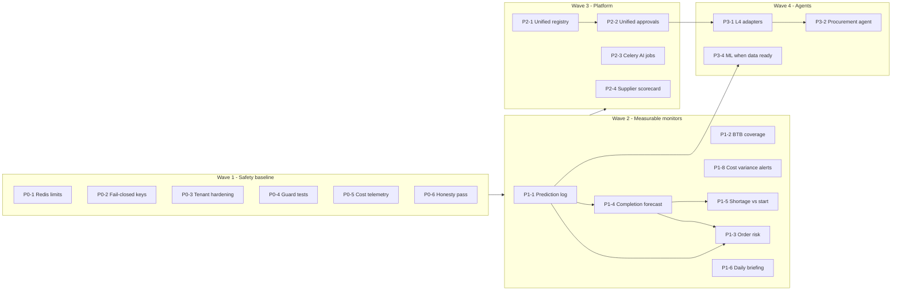

# 08 - Prioritised AI Development Roadmap

Part of the Prime7 AI strategy set. Index: [`AI_DEVELOPMENT_MASTER_PLAN.md`](AI_DEVELOPMENT_MASTER_PLAN.md).

**Audit date:** 2026-11-04
**Status:** Proposal for review. **No item below should be implemented until this roadmap is approved.**

---

## 1. Scoring framework

Each feature is scored 1 (worst) to 5 (best) on five criteria. The total is a weighted average out of 5.

| Criterion | Weight | 5 means | 1 means |
|---|---|---|---|
| Business impact (I) | 30% | Prevents late shipments, liquidity events, line stoppages, or a security incident | Nice to have |
| Data readiness (D) | 25% | All required data exists in the schema today | New data capture needed first |
| Engineering effort (E) | 20% | Days, reuses existing services | Many sprints, new subsystems |
| Reliability / risk (R) | 15% | Deterministic, easy to test and roll back | Probabilistic, hard to verify, touches money |
| Operating cost (C) | 10% | No LLM tokens | Paid model per request |

**Score = 0.30 I + 0.25 D + 0.20 E + 0.15 R + 0.10 C**

Effort estimates are rough engineer-week ranges for one developer familiar with the codebase. They are planning estimates, not commitments. Recurring AI cost is shown qualitatively (None / Low / Medium) because no usage data exists yet (see doc 06).

Priority classes:

- **P0 Critical fixes** - unsafe, broken or misleading existing AI behaviour
- **P1 Quick wins** - high value, existing data and infrastructure
- **P2 Strategic** - moderate engineering, platform consolidation
- **P3 Advanced** - agents with real execution, ML, new data capture

---

## 2. Scored backlog

### P0 - Critical fixes

| ID | Feature | Status today | I | D | E | R | C | Score | Effort | AI cost |
|---|---|---|---|---|---|---|---|---|---|---|
| P0-1 | Redis-backed AI rate limits and circuit breaker, keyed by authenticated user + tenant (risks S1, S2) | Per-process, header-keyed | 4 | 5 | 5 | 5 | 5 | **4.70** | 0.5-1 wk | None |
| P0-2 | Fail-closed permission keys for sensitive AI tools (finance, payroll, HR) (S3) | Missing key falls back to `ai.read` | 4 | 5 | 5 | 5 | 5 | **4.70** | 0.5 wk | None |
| P0-3 | Tenant hardening: remove `tenant_id=1` default in `PaidLlmProvider.generate`; refuse MCP calls without tenant context (S4, S5) | Latent | 4 | 5 | 5 | 5 | 5 | **4.70** | 0.5 wk | None |
| P0-4 | AI guard test pack (tenant, permission, commit gate, rate limit) (S9) | Mostly untested | 4 | 5 | 4 | 5 | 5 | **4.50** | 1-1.5 wk | None |
| P0-5 | Populate AI cost telemetry (`cost_estimate_usd`) and per-tenant usage report (S11) | Column never set | 3 | 5 | 5 | 5 | 5 | **4.40** | 0.5-1 wk | None |
| P0-6 | Honesty pass: label MCP write results as previews in UI; mark old AI status docs as superseded (S13, W3) | UI implies actions | 3 | 5 | 5 | 5 | 5 | **4.40** | 0.5 wk | None |

### P1 - Quick wins

| ID | Feature | Status today | I | D | E | R | C | Score | Effort | AI cost |
|---|---|---|---|---|---|---|---|---|---|---|
| P1-1 | Prediction-outcome log (`ai_prediction_log`) - foundation for measuring every score | Missing | 4 | 5 | 4 | 5 | 5 | **4.50** | 1 wk | None |
| P1-2 | BTB maturity vs cash coverage alert | Date-only rule exists | 5 | 4 | 4 | 5 | 5 | **4.55** | 1-1.5 wk | None |
| P1-3 | Unified order-risk score + TNA delay heatmap | Pieces exist (anomaly, control tower, TNA insights) | 5 | 4 | 4 | 4 | 5 | **4.40** | 2 wk | None |
| P1-4 | Production completion and shipment delay forecast (EWMA) | LLM text + heuristic adapter | 5 | 4 | 3 | 4 | 5 | **4.20** | 2-3 wk | None |
| P1-5 | Material shortage vs production start alert | MRP and shortage tools exist, not tied to line plan | 5 | 4 | 3 | 4 | 5 | **4.20** | 2 wk | None |
| P1-6 | Daily executive briefing, deterministic-first, with numeric consistency check (S10) | Brief + weekly report exist | 4 | 5 | 4 | 4 | 4 | **4.25** | 1-1.5 wk | Low |
| P1-7 | Dead-stock and aging action list | Aging service exists | 3 | 5 | 5 | 5 | 5 | **4.40** | 1 wk | None |
| P1-8 | Cost-variance alerts (order and CM variance into alert engine) | Variance computed, not alerted | 4 | 5 | 4 | 5 | 5 | **4.50** | 1 wk | None |
| P1-9 | Expand read-only chat tools to cover new monitors (risk, completion, BTB coverage, shortage) | Partial | 3 | 5 | 4 | 5 | 4 | **4.10** | 1 wk | Low |
| P1-10 | Structural prompt-injection defences and HR/payroll field masking (S6, S7) | Regex only | 4 | 5 | 4 | 4 | 5 | **4.35** | 1-1.5 wk | None |

### P2 - Strategic enhancements

| ID | Feature | Status today | I | D | E | R | C | Score | Effort | AI cost |
|---|---|---|---|---|---|---|---|---|---|---|
| P2-1 | Unified `ErpToolSpec` registry shared by chat and MCP | Two registries | 4 | 5 | 3 | 4 | 5 | **4.15** | 2-3 wk | None |
| P2-2 | Unified approval inbox (artifacts + governance + automation) | Three mechanisms | 4 | 5 | 2 | 4 | 5 | **3.95** | 3 wk | None |
| P2-3 | Real Celery AI jobs (nightly scores, forecasts, reindex) | Placeholders | 4 | 5 | 3 | 4 | 5 | **4.15** | 2 wk | None |
| P2-4 | Supplier OTD / QC scorecard | Data exists, no scorecard | 4 | 4 | 4 | 5 | 5 | **4.25** | 1.5-2 wk | None |
| P2-5 | Buyer DSO scorecard + structured payment terms (additive columns) | Terms are free text | 4 | 3 | 3 | 4 | 5 | **3.65** | 2-3 wk | None |
| P2-6 | Style / LC profitability by cost centre | Needs posting discipline | 4 | 3 | 3 | 4 | 5 | **3.65** | 2-3 wk | None |
| P2-7 | Crew gap and overtime optimiser | Data exists | 4 | 4 | 3 | 4 | 5 | **3.90** | 2-3 wk | None |
| P2-8 | Remove unused `prophet` / `statsmodels` (or defer until P3-4 uses them) | Unused | 2 | 5 | 5 | 4 | 5 | **3.95** | 0.5 wk | None |
| P2-9 | Fabric consumption closed loop (quote -> BOM -> issue -> wastage) | Parts exist | 4 | 4 | 3 | 4 | 5 | **3.90** | 2-3 wk | None |
| P2-10 | Consolidate experimental `erp_ai_phases` surfaces (copilot into chat, governance into inbox) | Duplicates | 3 | 5 | 3 | 4 | 5 | **3.85** | 2 wk | None |
| P2-11 | Chat streaming + Redis response cache | No streaming | 3 | 5 | 3 | 4 | 4 | **3.75** | 1.5-2 wk | Lowers cost |
| P2-12 | LC vs shipment document discrepancy rules | LC extract exists | 4 | 4 | 3 | 4 | 4 | **3.80** | 2 wk | Low |
| P2-13 | Tenant knowledge upload + background ingestion | Seed SOPs only | 3 | 4 | 3 | 4 | 4 | **3.50** | 2 wk | Low |

### P3 - Advanced intelligence

| ID | Feature | Status today | I | D | E | R | C | Score | Effort | AI cost |
|---|---|---|---|---|---|---|---|---|---|---|
| P3-1 | L4 validated service adapters, low-risk first (follow-up, inquiry, PO draft) | Simulation | 4 | 5 | 2 | 3 | 5 | **3.80** | 3-4 wk | None |
| P3-2 | Procurement recommender agent producing draft POs | Suggestions exist | 4 | 4 | 2 | 3 | 4 | **3.45** | 3 wk | Low |
| P3-3 | Approval recommender agent (advise, never approve) | None | 3 | 4 | 3 | 3 | 3 | **3.25** | 2-3 wk | Low-Medium |
| P3-4 | Classical/ML models on Celery, gated by data readiness (calibrated order risk, free-stock demand) | None | 4 | 2 | 2 | 3 | 5 | **3.05** | 4-6 wk | None |
| P3-5 | LLM template-selecting query planner (NL to safe query) | Keyword intents | 3 | 5 | 2 | 3 | 3 | **3.30** | 3 wk | Low-Medium |
| P3-6 | Operator productivity analytics (after bundle-scan capture) | No data | 4 | 1 | 1 | 4 | 5 | **2.75** | 6+ wk | None |
| P3-7 | CAPA root-cause assistant | None | 3 | 3 | 3 | 3 | 3 | **3.00** | 2-3 wk | Medium |
| P3-8 | Machine utilisation / IoT | No data | 3 | 1 | 1 | 4 | 5 | **2.45** | 8+ wk | None |

---

## 3. Recommended sequence

Ordering follows dependencies first, then score.

| Wave | Contents | Why this order | Indicative duration |
|---|---|---|---|
| 1 | P0-1 to P0-6 | Cheap, protects every later feature, gives cost visibility before usage grows | 3-4 weeks |
| 2 | P1-1, P1-2, P1-8, then P1-3, P1-4, P1-5, P1-6; P1-7, P1-9, P1-10 alongside | Prediction log first so every new score is measurable from day one; BTB and cost variance are fastest wins | 8-10 weeks |
| 3 | P2-3, P2-1, P2-2, P2-4, then remaining P2 | Platform consolidation before adding write capability | 10-14 weeks |
| 4 | P3-1, P3-2, P3-4 when data gates pass | Real execution only after unified approvals and tests exist | Ongoing |

---

## 4. Feature detail summary (P0 and P1)

For the ten blueprinted items, full specifications are in [09-top-10-feature-blueprints.md](09-top-10-feature-blueprints.md). The table gives the required fields for every P0 and P1 item.

| ID | Business problem | Expected benefit | Required changes | Data | Technical approach | AI model | Dependencies | Security | KPIs |
|---|---|---|---|---|---|---|---|---|---|
| P0-1 | Limits can be bypassed across workers | Predictable protection | `ai_tool/guardrails.py` | Redis | Redis INCR with TTL; fallback to memory | None | Redis (exists) | Key on authenticated ids | 429 rate consistent across workers |
| P0-2 | Sensitive AI tools open by default | Least privilege | `ai_tool/authz.py`, `tool_registry.py`, Settings -> Roles registry | Role permissions JSON | Sensitive key list; missing = deny for non-admin | None | Settings UI shows keys | Finance/HR data | Zero sensitive access without explicit grant |
| P0-3 | Latent wrong-tenant paths | Isolation guarantee | `paid_provider.py`, `mcp_server/tenant_guard.py` | - | Required parameter; refuse `None` context | None | - | Tenant isolation | Tests T1, T12 pass |
| P0-4 | Guards untested | Regression safety | `backend/tests/ai/` | Fixtures | Pytest, stub providers | Stub | - | All | Guard coverage list in doc 07 complete |
| P0-5 | AI cost invisible | Cost control by tenant | `ai_tool/audit.py`, provider clients, config price table, admin AI ops page | Token usage from providers | Multiply tokens by configured price | None | - | No secrets in logs | Cost per tenant per month |
| P0-6 | UI implies actions not taken | User trust | MCP result rendering in assistant UI; doc headers | - | Badge "Preview - not saved" | None | - | - | Zero support tickets about missing records |
| P1-1 | Scores cannot be validated | Accuracy measurement | New table + small service | Prediction + outcome | Additive migration; writer helper | None | Alembic | Tenant-scoped | % predictions with outcomes |
| P1-2 | BTB maturities can exceed available cash | Avoid default and expensive funding | New alert rule + coverage service | BTB tranches, bank balances, expected receipts | Rules | None | Alert engine (exists) | Finance permission | Uncovered maturities flagged >= 14 days ahead |
| P1-3 | Risky orders found too late | Fewer late shipments | Score service + heatmap UI | Orders, TNA, material, production | Weighted heuristic | Optional LLM explanation | P1-1, P1-4 | Merch permissions | Precision@10, late-shipment rate |
| P1-4 | Completion dates are guesses | Earlier action on delays | Forecast service + UI on planning page | Hourly production, line configs | EWMA | None (LLM text optional) | P1-1 | Production permissions | MAE in days |
| P1-5 | Lines stop for missing material | Fewer stoppages | Alert rule joining MRP balance with line plan start | MRP, line configs, POs | Rules | None | P1-4 helpful | Inventory permissions | Stoppages caused by material |
| P1-6 | Narratives may misstate numbers | Trustworthy briefing | Briefing service + checker | KPI snapshot | Template + small LLM + number check | Small model | Celery helpful | Finance redaction | % narratives passing check |
| P1-7 | Cash locked in old stock | Working capital | Action list on aging page | Aging, open demand | Rules | None | - | Inventory permissions | Aged stock value reduced |
| P1-8 | Margin leaks noticed late | Earlier correction | Alert rules over variance services | Costing variance, CM actuals | Rules | None | Alert engine | Merch/finance permissions | Variance caught before shipment |
| P1-9 | Chat cannot see new monitors | One place to ask | New read tools | New services | Read-only tools | Small model | Above items | Tool keys (fail-closed where sensitive) | Chat answer coverage |
| P1-10 | Untrusted text reaches models | Lower injection impact | Prompt builder, sanitiser | - | Delimiters, masking, output never controls tenant/tools | None | P0-2 | HR/finance data | Injection regression suite passes |

---

## 5. What not to do

- Do not build a separate AI platform per module; extend `ai_tool` and the existing alert engine (`backend/app/modules/merch/alert_engine.py`, `backend/app/models/alert.py`).
- Do not use an LLM to produce any forecast, balance, cost or payroll figure.
- Do not enable real AI commits (L4) before P2-1, P2-2 and P0-4 are complete.
- Do not deploy vLLM or GPU infrastructure until measured volume justifies it.
- Do not start ML training before P1-1 has collected outcomes for at least 6 months.
