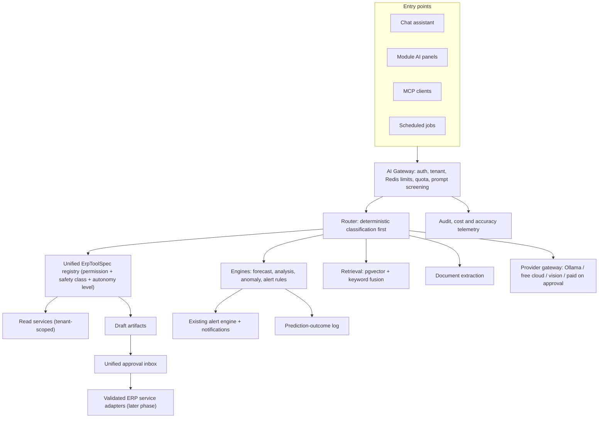

# Prime7 ERP - AI Development Master Plan

**Date:** 2026-11-04
**Status:** Investigation complete. Roadmap awaiting review and approval. **No implementation has started.**
**Detailed documents:** [`docs/ai-strategy/`](./)

---

## 1. Purpose

This master plan summarises a full investigation of Prime7's AI features and proposes how to make the ERP proactive and intelligent for garment manufacturers and buying houses, without adding cost or complexity it does not need. Every claim about the current system is backed by repository paths in the detailed documents. Items that need a running system to confirm are marked "Runtime-verify" there.

| Document | What it answers |
|---|---|
| [01 Existing AI architecture](./01-existing-ai-architecture.md) | How the AI layer is built today |
| [02 AI functionality audit](./02-ai-functionality-audit.md) | Which AI features exist in each of 15 ERP modules |
| [03 Module-wise opportunities](./03-module-wise-ai-opportunities.md) | Where intelligence adds value, and whether the data exists |
| [04 Agentic ERP architecture](./04-agentic-erp-architecture.md) | Safe path from read-only AI to approved actions |
| [05 AI / ML feasibility](./05-ai-ml-feasibility.md) | Rules vs statistics vs ML vs LLM per capability |
| [06 Infrastructure and cost](./06-infrastructure-and-cost.md) | What is deployed, model routing, cost controls |
| [07 Security and testing](./07-security-and-testing.md) | Risks, gaps and the AI test framework |
| [08 Prioritised roadmap](./08-prioritized-development-roadmap.md) | Scored P0-P3 backlog and sequence |
| [09 Top 10 blueprints](./09-top-10-feature-blueprints.md) | Implementation-ready specifications |
| [10 Executive summary](./10-executive-summary.md) | Answers to the five key questions |

---

## 2. Key findings

### 2.1 What exists (verified)

- A working AI layer in `backend/app/modules/ai_tool/` with 22 dedicated tables in `backend/app/models/ai_tool.py`, including pgvector embeddings.
- Model routing across OpenRouter (default, free model), local Ollama (`gemma2:2b`), optional vLLM (not deployed) and a paid tier used only after user approval (`ai_tool/llm_provider/__init__.py`).
- AI features across CRM, merchandising, costing, inventory, production planning, finance, HR, dashboards and the global assistant, mostly rules and heuristics with optional model-written text.
- Document extraction for LC, shipping, customer, quotation and HR documents, processed in memory only (`backend/app/modules/ai_extract/`).
- An existing alert engine (`backend/app/modules/merch/alert_engine.py`, `alert_rules.py`) with about 15 rules, including BTB maturity dates.
- Infrastructure: PostgreSQL with pgvector, Redis, Celery worker and beat, Ollama, all in both compose files. No GPU.

### 2.2 What is weak or missing

| Finding | Evidence | Priority |
|---|---|---|
| Rate limits and circuit breaker are per process; production runs 2 workers | `ai_tool/guardrails.py`, `docker-compose.prod.yml` | P0 |
| Finance and other sensitive AI tools default to allowed for any AI user | `ai_tool/authz.py:has_tool_permission` | P0 |
| Latent tenant default and weak MCP check without context | `paid_provider.py:PaidLlmProvider.generate`, `mcp_server/tenant_guard.py` | P0 |
| Guard functions almost untested | `backend/tests` | P0 |
| AI cost never recorded | `cost_estimate_usd` unused | P0 |
| AI "write" tools are simulations but the UI implies action | `mcp_server/erp_backend.py` | P0 |
| No accuracy measurement for any prediction | No prediction-outcome storage | P1 |
| Background AI jobs are placeholders | `backend/app/workers/forecast_worker.py`, `task_worker.py` | P2 |
| Two tool registries and three approval mechanisms | `tool_registry.py`, `mcp_server/tools.py`, artifacts, automation, governance | P2 |
| Prophet and statsmodels installed but unused | `backend/requirements.txt` | P2 |
| No BTB/import AI, no cutting-room AI, no trained ML | Code search | Roadmap |

---

## 3. Guiding principles

1. **Numbers from code, words from models.** No forecast, balance, cost or payroll figure is ever produced by a language model.
2. **Extend, do not rebuild.** Reuse the alert engine, costing variance, MRP, exposure, party ledger and existing AI tables.
3. **Cheapest adequate method.** Rules, then simple statistics, then ML only when data proves it helps; free or local models before paid ones.
4. **Humans approve what matters.** Voucher posting, LC commitments and salary or payroll changes always need an authorised person.
5. **Measure everything.** Log predictions with outcomes; record cost per tenant.
6. **Safe rollout.** Additive changes, feature flags OFF by default, reversible migrations, Docker-based verification.

---

## 4. Target architecture

Autonomy levels (doc 04): L1 read and explain, L2 analyse and recommend (both exist today), L3 prepare drafts (partial), L4 execute approved actions through validated services (future, after consolidation), L5 narrow pre-authorised automation (notifications and background scans only).

---

## 5. Development priorities

### Wave 1 - Safety baseline (about 3-4 weeks)

| ID | Task |
|---|---|
| P0-1 | Redis-backed AI rate limits and circuit breaker keyed by authenticated user and tenant |
| P0-2 | Fail-closed permission keys for sensitive AI tools |
| P0-3 | Remove tenant defaults; refuse MCP calls without tenant context |
| P0-4 | AI guard test pack |
| P0-5 | AI cost and usage telemetry |
| P0-6 | Show AI write results as previews; mark old AI status docs superseded |

### Wave 2 - Measurable proactive monitors (about 8-10 weeks)

| ID | Task |
|---|---|
| P1-1 | Prediction-outcome log |
| P1-2 | BTB maturity vs cash coverage alert |
| P1-8 | Cost-variance alerts |
| P1-4 | Production completion and shipment delay forecast |
| P1-3 | Unified order-risk score and TNA heatmap |
| P1-5 | Material shortage vs production start alert |
| P1-6 | Daily executive briefing with numeric consistency check |
| P1-7, P1-9, P1-10 | Dead-stock actions, chat tools for new monitors, prompt-injection and HR data masking |

### Wave 3 - Platform consolidation (about 10-14 weeks)

Unified tool registry and approval inbox, real Celery AI jobs, supplier scorecard, buyer DSO with structured payment terms, cost-centre profitability, crew and overtime optimiser, fabric consumption loop, consolidation of experimental screens, streaming and caching.

### Wave 4 - Advanced (ongoing, gated)

Validated L4 actions for low-risk drafts, procurement recommender, approval recommender, ML models only after six months of outcome data, operator productivity after bundle-scan capture.

Durations are planning estimates for one experienced developer, not commitments.

---

## 6. Operational impact and rollback

| Topic | Impact |
|---|---|
| Environment variables | Wave 1 adds optional settings with safe defaults (for example an AI model price table). No new required secrets. |
| Migrations | Wave 2 adds one new table (`ai_prediction_log`), fully reversible with `alembic downgrade -1`. Later additive columns are optional. |
| Permissions | Wave 1 makes sensitive AI tool keys explicit. Some roles may lose implicit finance/HR access through AI; run a role report and brief admins first. |
| Downtime | None expected; all changes are additive or behind flags. |
| Rollback | `git revert` for code; tenant feature flags OFF for new monitors; `ai_max_safety_class = READ_ONLY` as a global AI safety switch. |
| Verification | Backend checks run in Docker: `docker compose exec backend pytest -q`; frontend `npm run lint` and `npm run build`. Changes to auth, tenancy or migrations must be verified locally with `docker compose up` before pushing to `main`. |
| Tutorials | Any user-visible screen change must update Help & Tutorials in the same PR. |

---

## 7. Decisions requested

1. Approve the wave order and the P0 list.
2. Confirm which roles keep finance and HR data access through AI.
3. Confirm default assumptions for BTB cash coverage (collection days, safety buffer).
4. Decide whether to capture structured payment terms and shipment actual dates.
5. Set AI usage limits per plan once cost telemetry is live.

---

## 8. Investigation record

- Six specialist investigation passes were run in parallel: architecture, functional capability, business process, agentic workflow, ML feasibility with infrastructure and cost, and security with testing. The delegated security pass was blocked by a model-provider content filter, so security files were reviewed directly instead.
- Read-only inspection only. No database, secret, deployment configuration or live service was modified.
- Not performed: running the test suite, querying production data volumes, confirming which model provider answers in production, confirming Ollama model presence. These are listed as runtime checks in doc 06 section 6.
