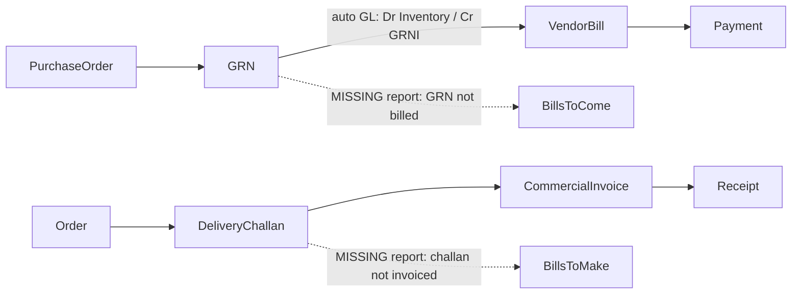

# P7 ERP vs Tally vs Akij ERP – gap list and roadmap

Research date: 2026-11-04. P7 status was checked against the code on this date.
Verified 2026-11-04 against code (second pass; the Excel row was corrected — `.xlsx` export already exists via the shared DataGrid).
Background: [TALLY_WORKFLOW.md](TALLY_WORKFLOW.md), [AKIJ_IBOS_WORKFLOW.md](AKIJ_IBOS_WORKFLOW.md).

Status legend: **EXISTS** = done, **PARTIAL** = some of it exists, **MISSING** = not built.

---

## 1. Summary

P7 already covers most of what Tally does in finance and inventory, and goes well beyond both Tally and Akij in RMG depth: BOM, TNA, colour × size, MRP, WIP, QC, maker-checker approvals, and auto GL posting from inventory.

The biggest gaps are **speed and convenience**, not features:
- report drill-down
- keyboard entry
- creating masters from inside forms
- exception reports
- per-voucher edit history

There are also a few **procurement and compliance** items that Akij has:
- Comparative Statement (CS)
- a cross-module approval inbox
- official NBR Mushak outputs
- an LC performance dashboard

---

## 2. Comparison

### 2.1 Finance

| Capability | Tally | Akij | P7 status | P7 evidence |
|---|---|---|---|---|
| Group-based chart of accounts with predefined groups | Yes (28 groups) | Yes | **EXISTS** | `backend/app/models/finance.py` (`AccountGroup`, `ChartOfAccount`), `backend/app/modules/finance/system_coa_templates.py` |
| Voucher types (payment, receipt, contra, journal, notes, memo, optional) | Yes | Yes | **EXISTS** | `DEFAULT_VOUCHER_TYPES` in `backend/app/modules/finance/router.py` |
| Sales / Purchase voucher inside finance | Yes (F8/F9) | Yes | **PARTIAL** – posted from commercial invoice and vendor bill instead | `backend/app/modules/commercial/commercial_invoice_service.py`, `/vendor-bills/{id}/post` |
| Post-dated, recurring, memorandum, voucher class | Yes | – | **EXISTS** (behind flags) | `backend/app/modules/finance/advanced_voucher_router.py` |
| Approval workflow (maker-checker) | No | Yes | **EXISTS** – better than Tally | `VOUCHER_WORKFLOW` in finance router, `frontend/src/pages/app/VoucherApprovalsPage.tsx` |
| Bill-wise outstanding and ageing | Yes | Yes | **EXISTS** (two parallel systems) | `BillReference` / `BillAllocation`; `backend/app/modules/finance/party_ledger_router.py` |
| Cost centres, budgets | Yes | Yes | **EXISTS** | `CostCenter`, `Budget`, `budget_enforcement_service.py` |
| Bank reconciliation (statement import) | Yes | – | **EXISTS** | `frontend/src/pages/app/BankReconciliationPage.tsx` |
| Cheque printing from a payment voucher | Yes | – | **PARTIAL** – templates only | `frontend/src/pages/settings/ChequeTemplatesPage.tsx` |
| Multi-currency | Yes | – | **EXISTS** | `/fx-receipts`, `/multi-currency/revaluation-summary` |
| Fiscal year / no year-end close | Yes | – | **PARTIAL** – calendar FY, period lock only | `frontend/src/pages/app/AccountingPeriodsPage.tsx` |
| TB, P&L, BS, Day Book, Cash Flow, Ratios | Yes | Yes | **EXISTS** | finance router, `backend/app/modules/finance/mis_reports_router.py` |
| **Drill-down report → ledger → voucher** | Yes (everywhere) | – | **MISSING** | `frontend/src/pages/app/TrialBalancePage.tsx`, `DayBookPage.tsx`, `FinancialStatementsPage.tsx` have no links. A drill target exists: `frontend/src/pages/app/LedgerActivityPage.tsx`, `VoucherDetailPage.tsx` |
| **Per-voucher edit log** | Yes (Edit Log) | – | **PARTIAL** – generic `AuditLog` exists, but the finance module never calls `log_action` | `/settings/audit` |
| Statutory VAT outputs | India GST, e-invoice | **Official Mushak forms (NBR-enlisted)** | **PARTIAL** – "Mushak 6.1/6.2 style" registers, not official NBR files | `backend/app/modules/compliance/bd_router.py` |

### 2.2 Inventory and procurement

| Capability | Tally | Akij | P7 status | P7 evidence |
|---|---|---|---|---|
| Stock groups / items / godowns / batches / serials | Yes | Yes | **EXISTS** | `backend/app/modules/inventory/`, `stock_hierarchy_router.py` |
| **Alternate units with conversion per item** | Yes (overridable per voucher) | – | **PARTIAL** – `/item-units` has no conversion factor; only costing materials do | `backend/app/models/costing.py` |
| PO → GRN → vendor bill | Yes | Yes | **EXISTS** | `frontend/src/pages/app/PurchaseWorkflowPage.tsx`, `grn_qc_router.py` |
| GRN accrual ("Purchase Bills to Come") | Yes | – | **EXISTS** in the ledger (Dr Inventory / Cr GRNI) | `backend/app/services/inventory_gl_service.py` |
| **Exception report: GRN received but not billed** | Yes | – | **MISSING** as a report | – |
| **Exception report: challan delivered but not invoiced** | Yes | – | **MISSING** | – |
| **Pre-close a PO / order balance with a reason** | Yes | – | **MISSING** (verify per module) | – |
| Purchase requisition → approval | – | Yes | **MISSING** for procurement (only HR job requisition exists) | `backend/app/models/hr_recruitment.py` |
| **RFQ + supplier quotations + Comparative Statement** | – | Yes | **MISSING** (the existing "comparative statement" is a finance period comparison, not a supplier CS) | `backend/app/modules/finance/comparative_statement_service.py` |
| Transfers, adjustments, physical count | Yes | Yes | **EXISTS** | `/warehouse-transfers`, `/stock-adjustments`, `/physical-inventory-sessions` |
| Valuation FIFO / Avg / Standard | Yes (per item) | – | **EXISTS** (tenant-level) | `stock_valuation_service.py`, `backend/app/services/fifo_inventory.py` |
| Negative stock policy | Warn only | – | **EXISTS** – configurable | `backend/app/common/inventory_policy.py` |
| Inventory → GL auto-posting | Yes | Yes | **EXISTS** | `backend/app/services/inventory_gl_service.py` |
| MRP, WIP, QC, colour × size | **No** | Partial | **EXISTS** – P7 is ahead | `docs/ORDER_EXECUTION_SPINE.md` |

### 2.3 UX, reporting and cross-module

| Capability | Tally | Akij | P7 status | P7 evidence |
|---|---|---|---|---|
| **Keyboard voucher keys (F4–F9, Ctrl+A)** | Yes | – | **PARTIAL** – only Ctrl+K, `/`, `?`, Esc | `frontend/src/components/shell/ShortcutSheet.tsx` |
| Command palette / global search | Go To (Alt+G) | – | **EXISTS** | `frontend/src/components/shell/CommandPalette.tsx` |
| **Create master on the fly (Alt+C)** | Yes | – | **PARTIAL** – inquiry and quotation forms only; not in voucher or PO forms | `QuickCreateFab.tsx` |
| **Excel (.xlsx) import/export** | Yes | – | **PARTIAL** – native `.xlsx` export **EXISTS** via the shared DataGrid (dependency `write-excel-file`, lazy-loaded). The finance report pages (Trial Balance, Day Book, Financial Statements) are still CSV-only, and `.xlsx` **import is MISSING** | `frontend/src/components/app/data-grid/exportRows.ts` (`exportXlsx`), `DataGrid.tsx`; CSV-only `@/lib/reportExport` |
| **Approval inbox across modules** | – | Yes | **PARTIAL** – finance only (vouchers, payment runs, bank reconciliation, periods); HR leave and payroll have their own pages | `frontend/src/pages/app/AllApprovalsPage.tsx`, `hr/leave/HrLeaveApprovalsPage.tsx`, `hr/payroll/HrPayrollApprovalsPage.tsx` |
| Order-wise cost vs profit | Cost tracking | Yes | **EXISTS** | `frontend/src/pages/app/merch/OrderProfitabilityPage.tsx`, `/finance/profitability/*`, `/orders/profitability-summary` |
| **LC performance dashboard** | – | Yes | **MISSING** (no commercial dashboard page) | – |
| Progressive feature switches | F11 / F12 | – | **PARTIAL** – flags exist, but not grouped as Basic / More / All | `backend/app/common/tenant_feature_keys.py` |
| Piece-rate wages | Production types | Yes | **MISSING / verify** (no `piece_rate` in backend) | – |

---

## 3. Roadmap

Every item below gets **its own small plan** before building, with a feature flag where risky, tests, and a rollback note. Each item follows the rules in `.cursor/rules/live-server-stability.mdc`: changes are additive, flags are OFF by default, and migrations are phased.

### Tier 1 – quick wins (low risk, mostly frontend, no migrations)

| # | Item | Source idea | Where | Notes |
|---|---|---|---|---|
| 1 | **Report drill-down**: Trial Balance / Financial Statements → Ledger Activity → Voucher; Day Book row → Voucher | Tally drill-down | `TrialBalancePage.tsx`, `FinancialStatementsPage.tsx`, `DayBookPage.tsx` → `LedgerActivityPage.tsx`, `VoucherDetailPage.tsx` | Pass ledger id + date range as query params. No API change expected. |
| 2 | **Keyboard voucher entry**: F4 Contra, F5 Payment, F6 Receipt, F7 Journal; Ctrl+Enter save; list them in the shortcut sheet | Tally keyboard-first | `VouchersPage.tsx` / voucher form, `ShortcutSheet.tsx` | Browsers reserve F5 (refresh) – use `preventDefault` only while on finance pages, or use Alt+number as a fallback. |
| 3 | **Create master on the fly (Alt+C)** from voucher, PO and GRN forms (ledger, item, supplier) | Tally Alt+C | voucher and PO forms | Reuse the inline-create pattern from the inquiry/quotation forms. |
| 4 | **Exception reports**: GRN not billed; challan not invoiced; negative cash/bank ledgers; overdue bills | Tally exception reports | new read-only endpoints in inventory/finance routers + one "Exceptions" page | Read-only queries; paginate with `backend/app/common/pagination.py`. |
| 5 | **Voucher history tab** (edit log) | Tally Edit Log | finance router (call `log_action` on create/update/state change) + `VoucherDetailPage.tsx` | Additive writes to the existing `AuditLog`; wrap in try/except so an audit failure never blocks posting. |

### Tier 2 – medium (backend + frontend; some behind flags)

| # | Item | Source idea | Notes |
|---|---|---|---|
| 6 | **Pre-close PO / order with reason** | Tally pre-close | New nullable columns `closed_reason`, `closed_at`, `closed_by`; pending reports exclude closed balances. Migration is reversible. |
| 7 | **Alternate units with conversion per item**, overridable on PO/GRN lines | Tally alternate units | Nullable `conversion_factor` on item-unit link; default 1. Flag `alt_units_enabled`. |
| 8 | **Purchase requisition → RFQ → supplier quotations → Comparative Statement → PO**, with recorded selection reason | Akij procurement | Largest Tier 2 item; new tables; flag `procurement_cs_enabled` (OFF by default). |
| 9 | **Unified approval inbox**: add HR leave, payroll, PO, BOM approvals to `AllApprovalsPage` | Akij approvals | Frontend aggregation first; backend summary endpoint later if slow. |
| 10 | **Excel (.xlsx) on finance reports + Excel import** | Tally Excel import | (a) Reuse the existing DataGrid `.xlsx` export (`exportXlsx` in `frontend/src/components/app/data-grid/exportRows.ts`) on the finance report pages that still use CSV-only `@/lib/reportExport`. (b) Add `.xlsx` import for masters and opening balances; this needs a reader library such as `read-excel-file`, because `write-excel-file` only writes. |
| 11 | **Print a cheque from a Payment voucher** | Tally cheque printing | Use the existing cheque templates; "Print cheque" action in the voucher Actions dropdown. |
| 12 | **Per-tenant fiscal year start + automatic carry-forward** | Tally "no year-end close" | Nullable `fiscal_year_start_month` on tenant settings (default January = current behaviour). Phased migration. |

### Tier 3 – strategic (separate, larger plans)

| # | Item | Source idea | Notes |
|---|---|---|---|
| 13 | **Official NBR Mushak outputs**: 6.3 invoice, 6.1/6.2.1 registers, 9.1 return, 6.10 flag | Akij Prime VAT | Needs a domain expert review of NBR formats; consider NBR enlistment requirements. |
| 14 | **Progressive feature settings page** (Basic / More / All) over `tenants.feature_flags` | Tally F11 | UI grouping only; no flag behaviour change. |
| 15 | **Optional "direct post" mode** for small tenants (save = post) | Tally save = post | Flag `direct_post_vouchers` OFF by default; maker-checker stays for everyone else. |
| 16 | **LC performance dashboard** (LC value, shipped, realised, outstanding) | Akij LC dashboard | Build on the existing commercial/LC data and `/finance/profitability/lc/{order_id}`. |
| 17 | **Piece-rate + daily-wage + salaried in one payroll run** | Akij PeopleDesk, Tally production types | Verify current HR payroll first. |

### Do not copy

- **Desktop / file-based data and branch sync.** P7's single multi-tenant database is better.
- **No approval workflow.** P7's maker-checker is a strength; keep it (item 15 is opt-in only).
- **Negative stock that only warns.** P7 already has a configurable `allow_negative_stock`.
- **Manufacturing as a posting after the fact** (no MRP / WIP / QC). P7 is already ahead.
- **Two overlapping cost systems.** Avoid adding a second "cost tracking" concept next to cost centres.
- **Unverified marketing claims** (for example "3–7 day implementation").

---

## 4. Delivery status (2026-11-04)

All 17 items were built, tested and wired front to back. Where the build differed from the plan above, the "How it was built" column says why.

| # | Status | How it was built | Flag / migration | Tests |
|---|---|---|---|---|
| 1 | DONE | `frontend/src/lib/financeDrilldown.ts`; FS → TB (by nature) → Ledger Activity → Voucher; Day Book → Voucher | none | lint / tsc |
| 2 | DONE | `frontend/src/hooks/useVoucherHotkeys.ts` (F4–F7, Alt+4–7, Ctrl+Enter, Ctrl+Shift+Enter); `?new=TYPE`; palette shortcuts | none | `useVoucherHotkeys.test.ts`, `createActions.test.ts` |
| 3 | DONE | `RemoteSearchSelect` gets `onCreateNew` + Alt+C; `components/quick-create/` ledger + vendor modals; vendor code auto `VEN-0001` | none | `test_benchmark_quick_create.py` |
| 4 | DONE | `backend/app/modules/finance/exception_reports_service.py` + `/finance/exceptions/*`; page `/app/accounts/reports/exceptions` | none | `test_benchmark_exception_reports.py` |
| 5 | DONE | `backend/app/modules/finance/voucher_history.py` (audit_logs, savepoint); `GET /vouchers/{id}/history`; `VoucherHistoryPanel` | none | `test_benchmark_voucher_history.py` |
| 6 | DONE | PO already had CLOSED; added reason + pending qty via `app/common/document_history.py` (no columns needed); `GET /purchase-orders/{id}/history` | none | `test_benchmark_po_preclose.py` |
| 7 | DONE | Item already had `alternate_unit` / `conversion_factor`; added edit fields + validation, and "Enter in" unit on PO lines (`lib/unitConversion.ts`) | none | `test_benchmark_alternate_units.py`, `unitConversion.test.ts` |
| 8 | DONE | `backend/app/modules/procurement/` + pages `/app/procurement/requisitions` | `procurement_cs_enabled` (off); **migration 244** (4 new tables) | `test_benchmark_procurement_cs.py` |
| 9 | DONE | `pages/app/approvals/approvalSources.ts` (PO, requisition, BOM, leave, payroll) + dashboard count | none | `test_benchmark_approval_inbox.py` |
| 10 | DONE | `downloadXlsx` on 4 finance reports; `.xlsx` import via `app/common/spreadsheet_upload.py` (openpyxl, already installed) — no new frontend library | none | `test_benchmark_excel_import.py` |
| 11 | DONE | `/app/accounts/vouchers/:id/cheque` with BD layout, amount in words (lakh/crore), printer offsets saved per browser (cheque templates were a stub) | none | `amountInWords.test.ts` |
| 12 | DONE | Stored in `feature_flags.fiscal_year_start_month` (no migration); `basis=fy` on TB / FS (P&L brought forward); voucher numbers follow FY | setting, default January | `test_benchmark_fiscal_year.py` |
| 13 | DONE (prepared, not filed) | `mushak_service.py`: 6.10, 9.1 draft summary, 6.3 tax invoice print; `feature_flags.vat_bin` | uses `bd_bond_compliance_enabled` | `test_benchmark_mushak.py`, `test_bd_registers.py` |
| 14 | DONE | Essential / More / All selector on Configuration (`pages/settings/featureTiers.ts`) | none | `featureTiers.test.ts` |
| 15 | DONE | `POST /vouchers/{id}/direct-post` walks every approval step; Save & Post / Post now | `direct_post_vouchers` (off) | `test_benchmark_direct_post.py` |
| 16 | DONE | `lc_performance_service.py` + `/commercial/lc-performance` page | none | `test_benchmark_lc_performance.py` |
| 17 | DONE | `PER_PIECE` and `PER_SAM_MINUTE` component types fed by shop-floor scans (operator code = employee code); min-wage warning | uses `payroll_auto_calculate_enabled` | `test_benchmark_piece_rate.py`, `test_payroll_auto_calculate.py` |

**Still needs people, not code:** item 13 — P7 is not NBR-enlisted VAT software; have a VAT consultant check 6.3 / 9.1 / 6.10 before filing. Item 17 — confirm piece rates and the minimum-wage top-up rule with HR.

## 5. Suggested order of work (original)

1. Items 1 and 4 (drill-down and exception reports): highest value for accountants and no risk.
2. Items 2, 3 and 5 (keyboard entry, create on the fly, voucher history).
3. Items 9 and 11 (approval inbox, cheque print): small, visible wins.
4. Item 8 (Comparative Statement): the biggest procurement gain for Bangladeshi buyers.
5. Item 13 (official Mushak): the compliance gap; plan with a VAT consultant.

Remember: shipping user-visible navigation or workflow changes requires updating Help & Tutorials in the same PR (see `.cursor/rules/tutorials-maintenance.mdc`).
