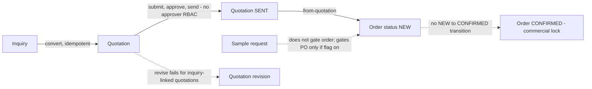
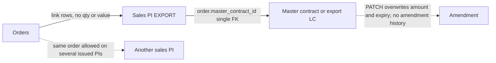
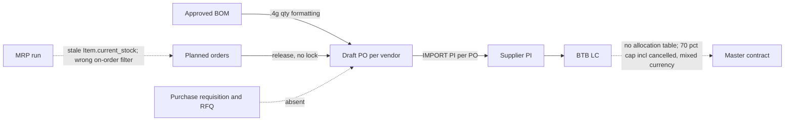
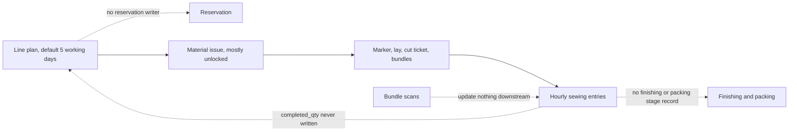
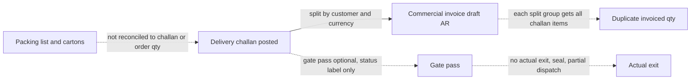
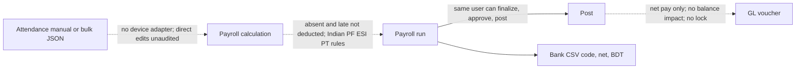

# Current State — Prime7ERP architecture and actual workflows

Audit date: 2026-11-03 · Evidence: static code inspection unless marked otherwise · Line numbers are approximate (`~`).
Paths are relative to the repository root. Finding IDs (e.g. `FIN-01`) are defined in [GAP_ANALYSIS.md](GAP_ANALYSIS.md).

---

## 1. Technology stack (verified from manifests and code)

| Layer | Technology | Evidence |
|---|---|---|
| Backend API | Python 3.12, FastAPI 0.115, Pydantic 2.10, Uvicorn (2 workers) | `backend/requirements.txt`, `backend/Dockerfile` |
| ORM / DB | SQLAlchemy 2.0 async + asyncpg; PostgreSQL 16 with pgvector; PgBouncer in local compose | `backend/app/database.py`, `docker-compose*.yml` |
| Migrations | Alembic, 243 revisions, single root | `backend/alembic/versions/` |
| Background | Celery 5.4 + Redis (worker, single beat) and 4 in-process asyncio loops guarded by `pg_try_advisory_lock` | `backend/app/common/celery_app.py`, `backend/app/main.py` `lifespan` ~L146–169, `backend/app/common/background_lock.py` |
| Frontend | React 18.3, Vite 6, TypeScript 5.6, React Router 7, Tailwind 3, i18next (en/bn); TanStack Query mounted but rarely used | `frontend/package.json`, `frontend/src/app/router.tsx`, `AppProtectedRouter.tsx` |
| Admin console | Separate React app at `/admin/` | `frontend-admin/` |
| AI | Gemini, OpenRouter, Ollama, vLLM adapters; pgvector + BM25 retrieval; MCP server | `backend/app/modules/ai_tool/`, `ai_extract/`, `governed_ai/`, `erp_ai_phases/`, `mcp_server/` |
| Delivery | GitHub Actions: CI (alembic + pytest on real Postgres, frontend lint/tsc/build/vitest); image build/push to Docker Hub on `main` and `v*` tags; **manual** SSH deploy via `scripts/deploy_production_remote.sh` | `.github/workflows/*.yml` |
| Production runtime | Docker Compose (`docker-compose.prod.yml`): postgres, redis, ollama, backend, worker, beat, nginx-served frontend, Watchtower | `docker-compose.prod.yml` |

Scale indicators: ~55 backend modules (~5 MB Python), 447 frontend page components, 138 backend test files (~556 tests),
14 frontend unit test files. `replit-legacy/primeX-ERP/` is a reference codebase (~55% of tracked files) and is **not** deployed.

## 2. System map

```mermaid
flowchart TB
  subgraph clients [Clients]
    WebApp["React app /app"]
    AdminApp["Admin console /admin"]
    CustPortal["Customer portal"]
    FinPortal["Financier portal"]
    ScanStation["Scan station offline queue"]
  end
  subgraph api [FastAPI monolith]
    Auth["auth, tenant, RBAC"]
    Merch["inquiries, quotations, orders, merch BOM, samples, TNA"]
    Commercial["commercial PI, master contract, BTB LC, commercial invoice"]
    Trade["trade_case, commission"]
    Inventory["inventory PO GRN stock MRP gate pass"]
    Production["production planning cutting hourly scan QC"]
    Mfg["manufacturing work orders NCR CAPA"]
    Finance["finance vouchers AP AR tax facility"]
    HR["hr attendance leave payroll compliance ESS"]
    BD["compliance bd registers"]
    AI["ai_tool ai_extract governed_ai mcp"]
    External["external_access portals"]
  end
  subgraph data [Data and jobs]
    PG[("PostgreSQL + pgvector")]
    Redis[("Redis")]
    Worker["Celery worker and beat"]
    Media[("media volume")]
  end
  WebApp --> api
  AdminApp --> api
  CustPortal --> External
  FinPortal --> External
  ScanStation --> Production
  api --> PG
  api --> Redis
  Worker --> PG
  api --> Media
  AI --> LLM["Gemini / OpenRouter / Ollama"]
```

### 2.1 Component status

| Component | Status | Notes |
|---|---|---|
| Inquiry, quotation, order, order BOM, commercial PI/contract/BTB, inventory core, finance vouchers, HR/payroll, external portals, scan station, commission | **Active** | Core live surface |
| Classic style-level BOM (`merch/routers/classic_boms.py`) vs order BOM (`merch/routers/boms.py`) | **Duplicated** | Two BOM paths with different validation (classic validates item tenant; order BOM does not) |
| Production (`modules/production`) vs manufacturing (`modules/manufacturing`) | **Duplicated / overlapping** | Two execution stacks: line-plan + hourly + cutting + QC vs work orders + operations + NCR/CAPA. Neither reconciles quantities with the other |
| Five AP/AR sub-ledgers (`OutstandingBill`, `BillReference`, `VendorBill`, party ledger bills, PI/commercial-invoice allocations) | **Duplicated** | Not reconciled to each other (FIN-08) |
| Legacy compliance router (`modules/compliance/router.py`) vs BD registers (`compliance/bd_router.py`) | **Duplicated; legacy unguarded** | Legacy bonded entry mounted without permission dependency |
| Costing module (`modules/costing`) | **Lookups only** | Real costing lives in quotation cost lines |
| Dyeing, washing | **Stub / absent** | Dyeing create/list only; washing only as a name |
| Knitting | **Active behind flag** (`knitting_enabled`, default off) | Coherent but delegates to inventory process orders |
| MCP commit tools | **Experimental (simulated)** | No real ERP writes |
| `StockReservation`, `inventory_stock_balance_snapshots` | **Disconnected** | Reservation table read but never written; snapshot rebuilt only by script |
| Cash forecast (`finance/router.py` `generate_cash_forecast` ~L3508) | **Placeholder** | Fixed multipliers over recent voucher averages |
| Tenant Settings → Backup/Restore | **Non-functional** | Writes an audit row and reports success (OPS-01) |
| `replit-legacy/` | **Reference only** | Not deployed |

### 2.2 Cross-cutting mechanics (as implemented)

- **Tenancy:** `require_tenant` (`backend/app/common/tenant.py` ~L44–69) requires `X-Tenant-Id == user.tenant_id`; each handler then filters `tenant_id` manually. No database row-level security. Tenant type (`manufacturer` / `buying_house` / `both`) and `trade_enabled` are enforced **only in the frontend sidebar** (MER-07).
- **Authorization:** Router-level `require_internal_permission("<module>.access")` is a no-op unless tenant flag `rbac_enforcement="enforce"` (default `off`, `backend/app/common/tenant_feature_keys.py` ~L243). Fine-grained keys on `roles.permissions` fail open (missing ⇒ allowed). Several routers mount with no module gate (SEC-02).
- **Status machines:** central maps in `backend/app/common/workflow.py` (inquiry, quotation, order, BOM).
- **Money:** DB columns mostly `Numeric(18,4)`; arithmetic frequently via `float` in routers; some quantities stored as strings (GRN quantities). `TradeCase` money mapped as Float.
- **Posting to GL:** several independent paths (manual vouchers, `finance/auto_posting_service.py`, `services/inventory_gl_service.py`, `services/wip_gl_service.py`, payroll router, commercial BTB endpoints, commission, facility). See §4.
- **Feature flags:** `tenants.feature_flags` JSON; many execution gates default **off** (`tna_event_sync`, `require_order_id_on_shop_floor`, `line_allocation_confirm_enabled`, `sample_approval_gates_for_po`, `capa_blocks_challan`, `grn_quality_inspection_enabled`, `mrp_engine_enabled`, `batch_tracking_enabled`, `knitting_enabled`); R4/R5 features default **on** (`DEFAULT_ON_FEATURE_FLAGS`).

---

## 3. Reconstructed workflows

Each workflow lists: trigger/role · screens & endpoints · records · statuses/gates · calculations · stock · accounting · reversal · **breaks**.
Dotted arrows in diagrams (`-.->`) mark where continuity breaks.

### W1. Inquiry → quotation → sample → buyer approval → confirmed order

- **Trigger / role:** buyer inquiry; merchandiser.
- **Endpoints:** `modules/inquiries/router.py`; `modules/quotations/router.py` `create_quotation_from_inquiry` ~L550–657, submit ~L419, approve ~L443, send ~L467, revise ~L491; `modules/orders/router.py` `create_order_from_quotation` ~L933–999, `create_order` ~L488–585; samples `modules/merch/routers/samples.py`.
- **Records:** `inquiries`, `quotations` (+ materials, CM, other costs, size ratios), `orders` (`commercial_snapshot_json` frozen at conversion), `merch_sample_requests`.
- **Statuses:** inquiry DRAFT→SUBMITTED→CONVERTED; quotation DRAFT→SUBMITTED→APPROVED→SENT→CONVERTED; order DRAFT→{NEW, CONFIRMED}; **NEW→CANCELLED only**; samples requested→in_progress→submitted→approved/rejected.
- **Calculations:** quotation price = target × (1 + margin) (float, then quantized); cost roll-ups in `full_update_quotation` ~L1004.
- **Accounting:** none.

- **Breaks:** (1) orders converted from quotations are created as `NEW` (`orders/router.py` ~L976) and `ORDER_TRANSITIONS["NEW"] = {"CANCELLED"}` (`common/workflow.py` L50), so they can never reach the locked statuses and stay freely editable; change requests return `CHANGE_REQUEST_NOT_REQUIRED` (MER-01). (2) Quotation revise copies only the header and collides with the unique `(tenant, inquiry_id)` index (MER-02). (3) `PATCH /quotations/{id}` can set CONVERTED without an order. (4) Samples are not linked to buyer identity/evidence; no resubmission cycle (MER-04). (5) Order amendments are client-asserted records that do not change the order (MER-03).

### W2. Style / tech pack → BOM → costing → approved revisions

- **Endpoints:** `merch/routers/boms.py` (order BOM), `classic_boms.py`, `bom_prefill_service.py`, `bom_calculation_service.py`, `bom_workflow_service.py`.
- **Statuses:** BOM DRAFT→SUBMITTED→APPROVED→FROZEN; REJECTED→DRAFT. Approve/freeze gated by `merch.bom.approve/freeze` (fail-open keys).
- **Calculations:** net per unit = quotation consumption per dozen ÷ 12; gross = net × (1 + wastage% + process-loss%); required = order qty × gross. Float arithmetic; prefill sets wastage to 0.
- **Breaks:** `version_no` / `revision_of_bom_id` never written; FROZEN is terminal with no revise path; no unique active-BOM-per-order constraint; unit price editable after freeze with `bom.price_override`; order qty changes after approval not propagated (MER-05). No tech-pack, measurement-spec or size-wise consumption model (MER-06, verified absent within inspected scope).

### W3. Order → sales PI → export contract / LC → amendments

- **Endpoints:** `commercial/router.py` `create_master_contract` ~L751, `update_master_contract` ~L788–825, `create_proforma_invoice` ~L924–1027, `finalize_proforma_invoice` ~L1283.
- **Records:** `master_contracts` (`contract_type` SALES_CONTRACT | EXPORT_LC), `proforma_invoices` (direction EXPORT | IMPORT), link `proforma_invoice_orders` (no tenant_id, no qty/value), `orders.master_contract_id` (single FK).
- **Gates:** IMPORT PI requires contract + PO + matching vendor; one IMPORT PI per PO (partial unique index).

- **Breaks:** no explicit allocation quantities/values; server does not prevent the same order on multiple ISSUED export PIs; PI can be created directly as ISSUED; PI amount client-entered and not reconciled to orders or contract (COM-01); contract/LC amendments overwrite fields with no history (COM-02); `cost_center_id` not tenant-validated.

### W4. Material demand → MRP → requisition → supplier PI/PO → BTB LC

- **Endpoints:** `merch/bom_procurement_service.py` (BOM→PO), `inventory/mrp_engine_service.py` `run_mrp` ~L292–437, `inventory/mrp_idt_router.py`, `inventory/router.py` `create_purchase_order` ~L2600–2660, `commercial/router.py` `create_btb_lc` ~L2004–2092.
- **Calculations:** PO qty = required gross − already-ordered (all PO statuses, incl. cancelled); quantities serialized with `.4g` (4 significant digits — corrupts ≥10,000). MRP single bucket: `current_stock + on_order + firmed − reserved − gross`; on-order excludes the wrong status set (misses `FULLY_RECEIVED`), counts DRAFT, and double counts released planned orders.
- **BTB cap:** 70% hard-coded; sums all BTB LCs regardless of status/currency; float; no lock.

- **Breaks:** no requisition/RFQ/quotation comparison (INV-07); reservations never written (INV-06); MRP not time-phased and netting defects (INV-05); BTB allocation, cap and FX defects (COM-03).

### W5. Material arrival → gate entry → inspection → GRN → usable stock

- **Endpoints:** `inventory/router.py` `create_goods_receiving` ~L2900–3060, `_apply_grn_receive_goods` ~L3063–3323; `inventory/grn_qc_service.py` (flag `grn_quality_inspection_enabled`, default off).
- **Behaviour:** gate entry absent (free-text vehicle/challan fields). With QC off, accepted qty posts straight to the target warehouse. With QC on, full received qty goes to a Quarantine warehouse; inspection moves accepted/rejected/hold. GL: Dr Inventory / Cr GRNI at FIFO value (`services/inventory_gl_service.py` `post_grn_receipt_gl` ~L198).
- **Breaks:** no FX conversion at GRN (USD PO valued as BDT) (INV-02); over-receipt check not locked at PO line; HOLD sets inspection COMPLETED and strands stock; issue paths other than IDT can draw from quarantine; no GRN reversal endpoint; rejected goods remain in GRNI value → permanent residue (FIN-05).

### W6. Production planning → material reservation → issue → cutting → sewing → finishing

- **Endpoints:** `production/planning_router.py` (`assign_style` ~L183–218, `move_config`), `line_reservation_service.py`, `suggest_service.py`, `planning_advisory_service.py`; issues `inventory/router.py` `create_and_post_production_material_issue` ~L4579, `manufacturing/execution_router.py` `create_material_issue` ~L358; cutting `production/cutting_router.py`; hourly `production/hourly_router.py`; scan `production/scan_router.py`.

- **Breaks:** capacity formulas wrong (SMV ÷ order qty; machines × operators) (PRD-03); no over-production guard, no stage quantity ledger, `completed_qty` never written (PRD-02); hourly entries keyed without shift/order overwrite each other; bundle generation twice → 500; scans don't roll up; readiness uses style BOM not order BOM; tenant-ownership validation gaps (SEC-03, detail held privately).

### W7. External washing / processing → dispatch → receipt → reconciliation

- **Endpoints:** `inventory/router.py` process orders ~L4900–5160; knitting `production/knitting_router.py` ~L304–553; IDT `inventory/idt_service.py`.
- **Behaviour:** process-order issue (locked) creates OUT movement — stock leaves the books with no "at subcontractor" location; receipt is single and full; loss = input − output across UOMs; GL Inventory→WIP→FG via `services/wip_gl_service.py`.
- **Breaks:** no partial receipts; no subcontractor-held stock; IDT partial receipts overwrite received qty while adding IN movements (INV-09); no gate-pass reconciliation for outbound processing.

### W8. Inspection → rejection / rework → reinspection → release

- **Endpoints:** `production/quality_router.py` `upsert_qc_check` ~L142–204; `manufacturing/quality_router.py` NCR ~L346, CAPA ~L424; gate `merch/execution_gates.py` `assert_no_blocking_capa_for_orders` ~L96–111.
- **Breaks:** AQL absent (QA-01); no measurement checks; no reinspection link; CAPA/NCR never get `order_id` so the `capa_blocks_challan` gate cannot fire (PRD-01); pass + fail not checked against checked qty.

### W9. Packing → shipment → invoice → dispatch gate pass → actual exit

- **Endpoints:** `logistics/router.py` packing lists ~L390–535, `logistics/carton_service.py`; delivery challan `inventory/router.py` ~L4116–4337 (locked post, Dr COGS / Cr Inventory); `commercial/commercial_invoice_service.py`; gate pass `inventory/router.py` `create_enhanced_gate_pass` ~L4363.

- **Breaks:** split invoices double-count challan qty; consolidated challans mis-attribute qty (INV-04); gate pass has no lines, direction, returnable/overdue, seal, actual-exit time, or stock link; can be created already RELEASED (GATE-01).

### W10. Export documents → bank submission → realization → settlement

- **Implemented:** commercial invoice (draft AR in invoice currency); receipts allocated to EXPORT PIs or commercial invoices with idempotency (`proforma_receipt_service.py` ~L119, `commercial_invoice_service.py` ~L635); BTB `record-opening` / `record-documents-acceptance` / `record-realization` create **draft** vouchers in BDT at rate 1 (FIN-02).
- **Verified absent within inspected scope:** export bill / negotiation record, bank submission tracking, discrepancy handling, proceeds realization with FX gain/loss, short realization, bank charges posting, EXP form (COM-04).

### W11. Attendance → payroll → approval → payment → accounting

- **Endpoints:** `hr_attendance/router.py` (manual entries, bulk JSON, regularization); `hr_payroll/payroll_calculation_service.py` `calculate_employee_payroll` ~L221; `hr_payroll/router.py` finalize/approve/post ~L773–1005, bank file ~L1410.

- **Breaks:** HR-01 (statutory rules are Indian, not Bangladesh), HR-02 (attendance edits bypass regularization, no audit), HR-03 (OT multipliers not applied), FIN-03 (net-only posting without balance impact, double-post race), no maker/checker (FIN-06), bank file lacks account details.

### W12. Returns, claims, scrap, wastage, adjustments, order closure

- **Implemented:** return to supplier only via finance debit note (stock OUT without FIFO consumption; credits Purchase Return, not Inventory) (INV-10); wastage transactions are analytics only (no stock/GL); adjustments post at default cost without approval; physical count applies `counted − expected` snapshot (wrong if movements occur in between).
- **Verified absent within inspected scope:** buyer claims, customer returns into stock, order closure workflow (no order reaches COMPLETED via transitions).

---

## 4. Operational transactions → GL (as implemented)

| Source | Posting path | Status on creation | Notes |
|---|---|---|---|
| GRN receive | `inventory_gl_service.post_grn_receipt_gl` | POSTED | Dr Inventory / Cr GRNI; skipped silently if accounts/period missing |
| Delivery challan | `inventory_gl_service` ~L269 | POSTED | Dr COGS / Cr Inventory; `.first()` per item+warehouse mis-values duplicate lines |
| Process order / IDT / knitting | `services/wip_gl_service.py`, `inventory_gl_service` | POSTED | WIP paths; fail-closed with savepoint |
| Material issue (production) | `wip_gl_service` | POSTED | Legacy path debits COGS when WIP auto-post off |
| Stock adjustment / count | `inventory_gl_service` ~L518/~L567 | POSTED | |
| Vendor bill | `finance/router.py` `post_vendor_bill` ~L7412 | POSTED | Debits system GRNI code (may differ from GRN credit account); no 3-way match |
| Payment run | `execute_payment_run` ~L5149 | POSTED | Debits per-supplier auto-created AP accounts, not `ACCOUNTS_PAYABLE_TRADE` |
| Commercial invoice | `commercial_invoice_service` ~L557 | DRAFT | Invoice currency |
| PI receipt | `proforma_receipt_service` ~L194 | DRAFT | |
| BTB LC events | `commercial/router.py` ~L2222–2416 | DRAFT | BDT at rate 1.0 regardless of LC currency |
| Payroll | `hr_payroll/router.py` `post_run` ~L936–1005 | POSTED | Net only; balances not applied |
| Commission | `commission/router.py` ~L794 | DRAFT | Base currency, balanced |
| Facility (loans) | `facility/gl_service.py` | DRAFT | Accounts validated |
| Special / stock-transfer / recurring vouchers | `finance/advanced_voucher_service.py` | varies | Special vouchers lack balance check |

Trial balance and account balances aggregate `VoucherLine.amount` (transaction currency), not `base_amount`
(`finance/router.py` `_posted_movement_by_account` ~L3048) — FIN-01.

## 5. Tests and delivery evidence

- CI runs all backend tests against a migrated Postgres + Redis, and frontend lint/tsc/build/vitest (`.github/workflows/ci.yml`).
- Notable coverage gaps (no tests found): master contract CRUD, BTB cap and accounting endpoints, quotation revise, BOM freeze/revision, hourly production, cutting/bundles, work orders, NCR/CAPA gate, payroll GL amounts, multi-currency trial balance, gate pass, concurrent stock issue, cross-tenant FK writers.
- Existing tenant-isolation tests (11) passed on 2026-11-03 in the local container.
