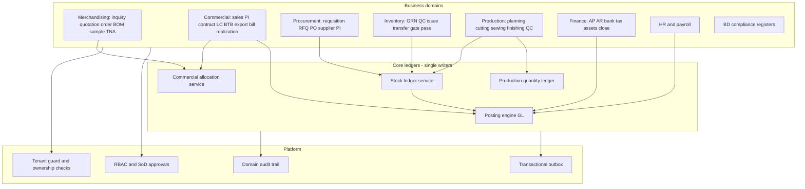

# Target Architecture — smallest justified change

Audit date: 2026-11-03. Builds on [CURRENT_STATE.md](CURRENT_STATE.md) and [GAP_ANALYSIS.md](GAP_ANALYSIS.md).
Everything here is a **proposal**; nothing has been implemented.

---

## 1. Architectural decision

**Keep the FastAPI + PostgreSQL modular monolith.** Do not rewrite, change language, change database, or split into microservices.

| Option | Verdict | Reason |
|---|---|---|
| Full rewrite | Rejected | Large working surface (55 modules, 243 migrations, live tenants); defects found are localized (validation, posting, quantity ledgers), not architectural dead ends |
| Microservices | Rejected for core ERP | Stock, GL, commercial and payroll need single-transaction consistency (e.g. GRN → stock movement → GL voucher). Splitting would require sagas for every posting and a larger ops team than exists |
| New database | Rejected | PostgreSQL + pgvector fits; problems are in application rules, not storage |
| Modularize inside the monolith | **Chosen** | Introduce a few internal domain services with clear ownership and enforce that modules call them instead of writing ledgers directly |
| Separate deployables | Only where justified: **IoT ingestion gateway** (bursty device traffic, edge buffering, different availability profile) and optionally an **AI worker pool** (long-running, cost-metered, isolatable). Both deferred to Phase 6 |

## 2. Domain boundaries (inside the monolith)

**Rule:** only the owning core service writes `vouchers/voucher_lines`, `stock_movements` (+ FIFO layers, reservations),
production quantity events, and commercial allocations. Domain modules call the service; direct inserts are removed over time.

### 2.1 Module disposition

| Area | Disposition |
|---|---|
| Inquiries, quotations, orders, order BOM, samples, TNA | Keep; fix status machine (MER-01), revisions (MER-02, MER-05) |
| Classic style BOM | Keep as template source; order BOM authoritative |
| Commercial | Keep; add allocations, amendments, export bill/realization |
| Inventory | Keep; route all stock writes through stock service |
| Production vs manufacturing | Choose one execution model (decision Q11); the other becomes a view/adapter; both write to the production quantity ledger meanwhile |
| Finance sub-ledgers | Converge on one open-item ledger; other tables become views |
| Legacy compliance router | Retire after migrating data into BD registers |
| Costing module | Keep as lookups |
| Dyeing/washing | Build only if in business scope (Q3) |
| AI modules | Keep governed pattern; tighten permission/approval |
| `replit-legacy/` | Retire from the main repository when parity reference no longer needed (move to an archive repo) |

## 3. Core services (new or consolidated)

### 3.1 Posting engine
- Single entry `post(source_type, source_id, action, lines, currency, rate, dimensions, idempotency_key)`.
- Enforces: Decimal arithmetic, debit = credit in **base** and transaction currency after rounding, open period, account ownership (tenant), dimension stamping (contract cost centre, order, department), idempotency via unique `(tenant, source_type, source_id, action)` (generalizes `inventory_gl_postings`).
- Corrections only by reversal; posted vouchers immutable; `cancel_posted_voucher` limited to manual vouchers inside open periods with SoD.
- Failure policy: if mapping is missing, write a **posting exception** row (queue) instead of a silent log; period close blocked while exceptions exist.
- Wraps existing `auto_posting_service`, `inventory_gl_service`, `wip_gl_service`, payroll, commercial, commission, facility paths incrementally.

### 3.2 Stock ledger service
- One balance definition (IN − OUT ± ADJUST by item × warehouse × status × owner × lot).
- Every stock-out acquires an ordered advisory/row lock per item-warehouse, checks availability vs policy, consumes FIFO layers, writes movement and calls the posting engine in the same transaction.
- New dimensions: `stock_status` (QUARANTINE, USABLE, REJECTED, HOLD), `owner_type/owner_id` (OWN, CUSTOMER, SUBCONTRACTOR-held), optional `lot/roll/shade`.
- Reservations written and consumed by the service; MRP and readiness read availability from it.
- Quantities and values Decimal; UOM conversion to item base UOM at document line.

### 3.3 Commercial allocation service
- Tables: `sales_pi_allocations` (pi_id, order_id, order_line/colour-size key, qty, value, currency), `contract_pi_allocations` (optional if PI ↔ contract is one-to-many), `btb_contract_allocations` (btb_lc_id, master_contract_id, amount_txn, amount_base, rate).
- Guarantees: sum of allocations ≤ source quantity/value; locks the source row; status-aware (cancelled releases).
- Amendment history tables for master contract/export LC, BTB LC, and orders (`*_amendments` with sequence, field deltas, bank reference, effective date, approver).

### 3.4 Production quantity ledger
- Event table: `(tenant, order_id, order_line_key, stage, bundle_id?, operation_id?, line_id, shift_id, qty, qty_type[INPUT|GOOD|REWORK|REJECT|TRANSFER_OUT|TRANSFER_IN], source, client_key, occurred_at)`.
- Hourly entries, scans, cutting, finishing, packing post events; WIP per stage and plan completion are derived. Over-production check against order qty + tolerance.
- Scan idempotency pattern (`client_key`) reused.

### 3.5 Approval and segregation-of-duties service
- Configurable policy per document type: preparer ≠ approver ≠ poster; thresholds; delegation.
- Used by quotation approval, BOM approve/freeze, PO approval, vouchers, payment runs, payroll, leave, AI proposals.

### 3.6 Domain audit trail
- `domain_audit_events(tenant, entity, entity_id, action, before_json, after_json, actor, reason, at)` written by core services and status changes; retained per policy; request-level log keeps reads sampled with retention.

### 3.7 Transactional outbox
- Replace `try/except: pass` side effects (TNA sync, notifications, AI nudges) with outbox rows committed with the business transaction and processed by Celery with retry/dead-letter. Avoids rolled-back side effects and poisoned sessions (PRD-13 pattern).

## 4. Data model changes (additive first)

| Change | Type | Notes |
|---|---|---|
| `order` transition `NEW→CONFIRMED` (+ `IN_PROGRESS`, `COMPLETED`, `CLOSED`) | code + data backfill | No schema change |
| `quotation_versions` or `quotations.parent_quotation_id`, `revision_no` | add columns | Drop/replace unique `(tenant, inquiry_id)` with partial unique on active revision (requires confirmation) |
| BOM: write `version_no`, `revision_of_bom_id`; partial unique active BOM per order | constraint after dedupe | Data cleanup first |
| `sales_pi_allocations`, `btb_contract_allocations`, `*_amendments`, `export_bills`, `export_bill_realizations`, `bank_charges` | new tables | Backfill from existing links/amounts |
| `proforma_invoice_orders.tenant_id` | add nullable → backfill → NOT NULL | Phased |
| `stock_movements`: `stock_status`, `owner_type`, `owner_id`, `lot_id` | add nullable with defaults | Backfill USABLE/OWN |
| `stock_reservations` writer | no schema change | Service only |
| `posting_exceptions`, generalized `gl_posting_keys` | new tables | |
| `production_qty_events` | new table | Backfill from hourly entries where possible |
| `aql_plans`, `aql_sample_size_codes`, `aql_acceptance`, `inspection_lots` | new tables | Standard tables loaded from licensed source by quality owner |
| `gate_pass_lines`, gate pass `direction`, `returnable`, `expected_return_at`, `actual_exit_at`, `seal_no` | add | |
| `trade_cases` money → `Mapped[Decimal]` | model only (DB already Numeric per migration 072) | Verify DB type first |
| Payroll: jurisdiction rule sets, OT basis, advances schedule, piece-rate tables | new tables | |
| `domain_audit_events`, `outbox_events` | new tables | |
| Composite `(tenant_id, id)` unique keys + composite FKs on high-risk relations | constraints | Only after production cross-tenant data scan is clean |

All migrations follow the repository rule: additive, nullable → backfill → constrain in separate revisions, working `downgrade()`.

## 5. Tenant isolation — defence in depth

| Layer | Proposal | Trade-offs | When |
|---|---|---|---|
| 1. Ownership helper | `await owned(db, Model, id, tenant_id)` used by every writer for client-supplied FKs; Pydantic body scanning test that fails CI when a persisted `*_id` field lacks an ownership check | Cheap, immediate; relies on discipline + test | Phase 1 |
| 2. Composite foreign keys | `UNIQUE(tenant_id, id)` on parent tables and `FOREIGN KEY (tenant_id, x_id)` on high-risk children | DB-enforced; requires clean data and many migrations | Phase 2–3, after data scan |
| 3. Postgres RLS | Policies on tenant tables using `SET LOCAL app.tenant_id` per transaction; platform/admin role bypass | Strongest; must handle async pool + PgBouncer transaction mode, background jobs, platform admin paths; run shadow (log-only via views/tests) first | Phase 3+ (evaluate) |
| 4. RBAC enforce | Shadow → enforce per tenant; explicit grants for finance/HR/approval keys | Operational change; needs role matrix with customers | Phase 0–2 |

## 6. Integrations

| Integration | Current | Target | Notes |
|---|---|---|---|
| Biometric attendance (e.g. ZKTeco-class devices) | None (bulk JSON) | Adapter service pulling punches into raw punch table with device identity, dedupe, timezone; HR processes into attendance | Device SDK/protocol to be confirmed with hardware in use |
| Bank payment files / MFS | CSV of code, net, BDT | Bank-specific formats, MFS bulk files from approved runs; acknowledgement import | Formats from each bank |
| Bank statements | CSV import, matches payment runs | Match any bank voucher line; MT940/CAMT if banks provide | |
| BD compliance (UD/UP, bond, Mushak, EXP) | Register + CSV/XLSX export | File exports in authority formats where published; acknowledgement capture fields | **No API availability assumed.** Compliance owner to provide authoritative sources and effective dates |
| BGMEA/BKMEA | Not found | Document preparation + acknowledgement capture | Manual submission |
| Buyer portal | Customer portal (orders, approvals, shipments, notes) | Add sample approval evidence capture | Retain |
| Supplier portal | Model exists (`supplier_portal`) | Extend for PI/ASN upload | Not fully verified |
| IoT | None | Gateway (MQTT/OPC UA where machines support it) → edge buffer → ingestion API with device registry | Phase 6 |
| AI providers | Gemini/OpenRouter/Ollama | Approved provider list per data class; local model for sensitive data | Decision Q10 |

## 7. IoT target design (Phase 6)

- **Device identity:** registry table (device id, type, location, line, certificate/API key, calibration date); per-device credentials, not user JWTs.
- **Ingestion:** gateway accepts MQTT/HTTP batches; each event has device id, monotonic sequence, device timestamp, server receive timestamp; dedupe on `(device_id, sequence)`.
- **Edge buffering:** store-and-forward on gateway; replay window; clock-skew detection.
- **Calibration and reconciliation:** periodic counter vs QC-accepted reconciliation per line/shift; variance alerts, never automatic output posting.
- **Output rule:** machine counts feed utilization/OEE and anomaly alerts only; accepted output remains QC-accepted bundle/operation quantities in the production quantity ledger.

## 8. AI use-case cards

| Use case | Problem / user | Required data | Deterministic baseline | Technique | Integration | Human approval | Metric | Failure / fallback | Cost drivers | Earliest phase |
|---|---|---|---|---|---|---|---|---|---|---|
| Document extraction (PI, LC, invoice, BOE) | Commercial/stores clerks retyping documents | Document images/PDF; target form schema | Manual entry | Multimodal LLM extraction → schema validation (exists: `ai_extract`) | Form autofill only | User reviews every field before save | Field-level accuracy; time saved per doc | Show empty fields; manual entry | Tokens per page; model tier | Now (retain; add accuracy logging) |
| Permission-aware ERP assistant | Managers asking status questions | Tenant data via tools; documents | Saved reports and filters | Tool-calling LLM with per-user permission filters on tools and retrieval | `ai_tool` registry | Read-only; actions via proposals | Answer correctness on golden set; permission-violation rate = 0 | Refuse when tool denied; link to report | Tokens; retrieval | Phase 2 (after SEC-08 fixes) |
| Consumption and costing support | Merchandisers estimating consumption | Historical BOM, marker efficiency, actual issue vs BOM | Formula consumption + wastage tables | Regression on history; LLM explanation | Quotation costing suggestions (exists) | Merchandiser accepts per line | MAPE vs actual consumption | Fall back to formula | Small; batch | Phase 4 (needs PRD-02 actuals) |
| Scheduling and bottleneck prediction | Planners | Corrected capacity, SMV, actual hourly output, absenteeism | Corrected deterministic capacity plan (PRD-03) | Heuristic/OR scheduling; ML on actual efficiency later | Plan board suggestions | Planner applies moves | Plan adherence; OTD | Deterministic plan | Compute | Phase 6 (after Phase 4 data) |
| Cash forecasting | Finance manager | Open AR/AP, LC maturities, payroll calendar, realization history | Rule-based schedule from open items (FIN-10 rebuild) | Probabilistic delays on top of schedule | Finance dashboard | Advisory only | Forecast error by horizon | Deterministic schedule | Small | Phase 5 |
| Predictive maintenance | Maintenance | Machine telemetry, downtime events | Preventive schedule by hours | Anomaly detection on telemetry | Downtime module | Technician confirms work order | Unplanned downtime reduction | Preventive schedule | Telemetry storage | Phase 6+ (needs IoT) |
| Computer-vision inspection | QC | Labeled defect images per product | AQL sampling with human inspectors (QA-01) | CV defect detection as inspector assist | QC entry | Inspector confirms each defect | Precision/recall vs inspector | Human inspection | Cameras, GPU, labeling | Phase 6+ (pilot) |

## 9. Non-functional targets

- **Backups:** scheduled logical + base backups with off-site copy; documented RPO ≤ 24h initially (target ≤ 1h with WAL archiving) and tested RTO; restore drill each quarter.
- **Observability:** error tracking, request IDs, structured logs, slow-query and posting-exception dashboards.
- **Delivery:** images published only after CI success; no auto-update of application containers; staged rollout via feature flags.
- **Precision:** Decimal for all money/quantity arithmetic; quantities `Numeric(18,4)` minimum; money `Numeric(18,4)`; rates `Numeric(18,6)`.
