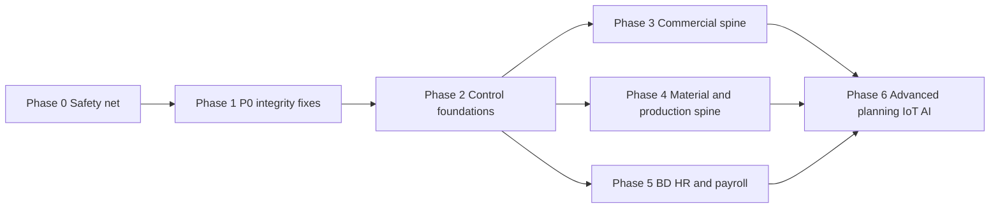

# Upgrade Roadmap — phased implementation and migration

Audit date: 2026-11-03. Task detail in [BACKLOG.md](BACKLOG.md); rationale in [GAP_ANALYSIS.md](GAP_ANALYSIS.md) and [TARGET_ARCHITECTURE.md](TARGET_ARCHITECTURE.md).
Durations are indicative ranges for a small team (2–3 engineers + 1 QA/BA), not commitments.

## Operating rules for every phase (protect live factories)

1. **Backup before change:** no migration ships until Phase 0 backups and a restore drill exist. Every release with Alembic revisions requires a confirmed production backup (see `.cursor/rules/deployment-process.mdc`).
2. **Additive first:** nullable column → backfill → constraint, in separate revisions with working `downgrade()`.
3. **Flags for behaviour change:** new validation that can reject previously accepted input ships behind a tenant flag in *warn* mode (log + response header) before *enforce*.
4. **Measure, then fix data, then enforce:** each integrity fix has a read-only reconciliation report run before and after.
5. **No silent historical edits:** historical financial corrections use dated compensating vouchers approved by the tenant's accountant; stock corrections use adjustment documents with reason codes.
6. **One module per release** where possible; release notes and Help & Tutorials updated with any user-visible change.
7. **Rollback:** image pin to previous tag + `alembic downgrade` for additive revisions; flags off for behaviour.

## Dependency overview

## Data cleanup dependencies

| Upgrade | Requires first | Reconciliation report |
|---|---|---|
| Base-currency TB (FIN-01) | `voucher_lines.base_amount` populated and correct for historic lines | Per account: Σamount vs Σbase_amount; lines with currency ≠ base and base_amount = 0 |
| BTB voucher currency (FIN-02) | List of existing BTB vouchers with LC currency ≠ BDT | Voucher vs LC amount × rate difference |
| `.4g` fix (INV-01) | Identify PO/GRN lines with quantity ≥ 10,000 and ≤ 4 significant digits | Lines likely rounded; compare to BOM required qty |
| GRN FX (INV-02) | Foreign-currency POs with GRNs | Value difference per GRN; GRNI impact |
| PI allocations (COM-01) | Duplicate order links across ISSUED PIs | Orders on >1 issued export PI; PI amount vs order value |
| Order status (MER-01) | Count of orders in `NEW` by age and downstream activity | Orders with BOM/PO/challan but status NEW |
| Composite tenant FKs (SEC-04) | Cross-tenant FK scan = 0 or triaged | Per relation listed in private findings |
| Single stock balance (INV-08) | Variance between formulas and caches | Item × warehouse variance list |
| BOM uniqueness (MER-05) | Duplicate active BOMs per order | Duplicate list |
| Reference uniqueness (COM-06) | Duplicate LC/PI references | Duplicate list |
| Payroll BD rules (HR-01/03) | Confirmation of statutory parameters by compliance owner | Golden payroll cases |

---

## Phase 0 — Safety net (no business behaviour change)

- **Scope:** working backups + restore drill (OPS-01); hide or correct the tenant Settings backup UI; error tracking and request IDs (OPS-02); CI-gated image publishing and Watchtower scoping (OPS-03); RBAC **shadow** mode report per tenant (SEC-01); read-only reconciliation scripts for every item in the data cleanup table; production read-only cross-tenant FK scan; decision on repository visibility (SEC-10) and AI provider policy (SEC-11).
- **Dependencies:** server access; owner decisions Q9, Q10.
- **Migration/backfill:** none (scripts are read-only).
- **Compatibility:** no API change.
- **Rollout:** infra first (backups), then CI change, then scripts run by an operator.
- **Rollback:** revert workflow/compose changes; scripts have no side effects.
- **Tests:** restore into staging and run `pytest` + smoke; CI pipeline proves image push blocked on failing test.
- **Reconciliation:** baseline reports archived (dated) for later comparison.
- **Training:** operator runbook for backup/restore; admin briefing on RBAC shadow report.
- **Exit criteria:** successful timed restore (RTO measured); off-site copy verified; error tracking receiving events; baseline reconciliation reports produced; owner decisions recorded.
- **Indicative effort:** 1–3 weeks.

## Phase 1 — P0 integrity fixes (small, flag-guarded)

- **Scope:** SEC-03 tenant ownership checks on all confirmed writers (+ CI test sweep for persisted `*_id` fields); INV-01 Decimal quantities; INV-02 GRN base-currency costing; INV-03 locked stock-out paths via one helper; INV-04 split/consolidated invoice quantities; COM-01 server-side PI over-allocation block (interim, before full allocation table); FIN-01 base-currency TB (report switch with comparison view); FIN-02 BTB voucher currency; FIN-03 payroll posting (gross/deductions/balances, lock, unique posting); FIN-04 posted-voucher immutability for system vouchers + balance check at post; FIN-05 GRNI account resolver + posting-exception queue; HR-03/HR-04 pay calculation and pay-setup guards; MER-01 order confirmation transition; PRD-13 rollback fix.
- **Dependencies:** Phase 0 baselines.
- **Migration/backfill:** additive only (`posting_exceptions`, `gl_posting_keys` if needed, `proforma_invoice_orders.tenant_id` nullable + backfill). Historical corrections via compensating vouchers/adjustments after accountant review — not automatic.
- **Compatibility:** responses unchanged; new 4xx for previously accepted invalid input (foreign ids, over-allocation) — introduced in warn mode first where business impact is possible (COM-01, INV-03 negative stock policy).
- **Rollout:** per fix, behind flags where behaviour changes; enable per tenant after UAT; TB shows both old and base views for one close cycle.
- **Rollback / compensation:** flag off; image pin; reversing compensating vouchers if posted in error.
- **Tests:** regression test per finding (including the four runtime-reproduced isolation cases), concurrency tests for stock-out and payroll post, multi-currency TB test, split-invoice test.
- **Reconciliation:** rerun Phase 0 reports; expected deltas documented and signed by tenant accountant/stores lead.
- **Training:** finance (TB views, posting exceptions queue), stores (negative stock messages), merch (order confirmation step).
- **Exit criteria:** all P0 findings closed or formally risk-accepted; reconciliation deltas explained; no new posting exceptions unresolved > 2 days.
- **Indicative effort:** 6–10 weeks.

## Phase 2 — Control foundations

- **Scope:** posting engine consolidation (all GL writers through one service); approval/SoD service (FIN-06, MER-08, INV-20); domain audit trail (SEC-13); fail-closed permissions for finance/HR/approval keys (SEC-05); RBAC enforce per tenant (SEC-01); module gates on all routers (SEC-02) and backend tenant-type enforcement (MER-07); period lock coverage + configurable fiscal year (FIN-07); Decimal arithmetic in vouchers (FIN-13); vendor bill uniqueness (FIN-18); TradeCase Decimal (MER-14); trade case PATCH bypass (MER-13); retire legacy compliance route (BD-03); MFA for platform admins (SEC-09); outbox for side effects.
- **Dependencies:** Phase 1 posting fixes; role matrix agreed with each tenant.
- **Migration/backfill:** `domain_audit_events`, `outbox_events`, `approval_policies`; composite tenant unique keys on parent tables (no child FKs yet).
- **Compatibility:** users may lose access they implicitly had (fail-open → explicit) — announced, with shadow reports beforehand.
- **Rollout:** tenant by tenant: shadow → enforce; SoD policies start as warnings.
- **Rollback:** tenant flag back to shadow; policies to warn.
- **Tests:** permission matrix tests per router; SoD tests; audit event assertions.
- **Reconciliation:** compare posting outputs before/after consolidation on a replayed sample month (same TB).
- **Training:** admins (roles, approvals), all users (approval inbox).
- **Exit criteria:** every router gated; every GL write via posting engine; SoD active for vouchers, payments, payroll, PO, quotation; audit events present for price/qty/status/pay changes.
- **Indicative effort:** 8–12 weeks.

## Phase 3 — Commercial spine

- **Scope:** sales PI allocations with qty/value (COM-01 full); contract/LC and order amendments with history (COM-02, MER-03); BTB contract allocations and status/FX-aware locked cap (COM-03); export bill, bank submission, discrepancy, realization, short realization, bank charges, FX difference postings (COM-04, FIN-09); exposure reporting (COM-09); reference uniqueness (COM-06); quotation and BOM revisions (MER-02, MER-05).
- **Dependencies:** Phase 2 posting engine and SoD; FX rate source agreed (Q12).
- **Migration/backfill:** create allocations from existing link rows (qty = order qty, value = PI amount pro-rata, flagged `backfilled`); create BTB allocations from FK at 100%; amendments start from current header as sequence 0.
- **Compatibility:** existing PI/BTB endpoints keep accepting current payloads; allocation fields optional initially with server-derived defaults.
- **Rollout:** per tenant with commercial team UAT on one live contract end-to-end.
- **Rollback:** flags; allocation tables ignored by readers when flag off.
- **Tests:** over-allocation, amendment, cap under concurrency, partial shipment/realization, short realization FX.
- **Reconciliation:** contract headroom = contract value − Σ BTB allocations (base) matches bank statements for sample contracts.
- **Training:** commercial team (allocations, amendments, realization), finance (FX postings).
- **Exit criteria:** one full contract lifecycle (orders → PI → contract → BTB → shipment → export bill → realization) completed in UAT with balanced GL and correct exposure report.
- **Indicative effort:** 10–14 weeks.

## Phase 4 — Material and production spine

- **Scope:** stock ledger service with status/ownership dimensions, reservations, single balance (INV-03, INV-06, INV-08, INV-11, INV-14); MRP netting fixes (INV-05); GRN reversal, return-to-vendor, IDT/process-order partial receipts (INV-09, INV-10, INV-12); gate pass lines and reconciliation (GATE-01); production quantity ledger, over-production guard, plan completion (PRD-02, PRD-04); corrected capacity formulas (PRD-03); CAPA order link (PRD-01); work-order fixes (PRD-09); readiness from order BOM (PRD-10); AQL plans (QA-01); physical count fix (INV-17); roll/lot/shade (INV-13) if confirmed.
- **Dependencies:** Phase 2; execution-model decision (Q11); AQL standard source (Q13).
- **Migration/backfill:** movement dimensions default USABLE/OWN; production events backfilled from hourly entries (marked `backfilled`); quarantine warehouse stock mapped to QUARANTINE status.
- **Compatibility:** existing screens read derived figures; scan station unchanged (adds events).
- **Rollout:** pilot one factory/line; parallel run of old and new WIP figures for 2 weeks.
- **Rollback:** flags; derived figures fall back to old queries.
- **Tests:** concurrency, partial receipts, reservation lifecycle, over-production, AQL sample-size and Ac/Re cases, gate pass reconciliation.
- **Reconciliation:** physical count vs ledger on pilot warehouse; WIP by stage vs line supervisor counts.
- **Training:** stores, cutting, line supervisors, QC, security guards.
- **Exit criteria:** pilot factory runs one order from GRN to shipment with stock/WIP/QC figures reconciled within agreed tolerance.
- **Indicative effort:** 12–18 weeks.

## Phase 5 — Bangladesh HR and payroll

- **Scope:** jurisdiction rule sets (BD wage grades, OT basis, festival bonus, WPPF, income tax) validated by compliance owner (HR-01); proration, absence/late deductions (HR-03); piece rates, incentives, arrears, final settlement, advance recovery (HR-05, HR-09); attendance edits via regularization only with audit and lock (HR-02); device adapter (HR-06); bank/MFS payment files (HR-07); compliance registers (HR-08).
- **Dependencies:** Phase 2 (SoD, audit), Phase 1 payroll posting; Q8.
- **Migration/backfill:** rule sets effective-dated; existing structures mapped; no retroactive recalculation of closed periods.
- **Compatibility:** Indian rule set retained for tenants that use it (if any).
- **Rollout:** parallel payroll for 2 cycles (old vs new) per tenant before cut-over.
- **Rollback:** revert to previous rule set version for open period.
- **Tests:** golden payroll cases signed by HR/compliance; attendance lock tests.
- **Reconciliation:** parallel-run differences explained per employee.
- **Training:** HR/payroll officers, accounts.
- **Exit criteria:** two consecutive parallel cycles with zero unexplained differences; payment file accepted by bank.
- **Indicative effort:** 8–12 weeks.

## Phase 6 — Advanced optimization

- **Scope:** time-phased MRP with lead times and scheduled receipts; requisition/RFQ/comparison (INV-07); capacity planning with skills/machines/changeover (PRD-06, PRD-07); IoT gateway (IOT-02) with device registry; AI cards from TARGET_ARCHITECTURE §8 in their stated phases; multi-entity accounting if required (FIN-12); RLS evaluation (SEC-04 layer 3); landed cost, UOM conversion, fixed assets.
- **Dependencies:** Phases 3–5 data quality.
- **Exit criteria:** defined per sub-project; AI features only with baseline comparison and evaluation metric.
- **Indicative effort:** ongoing, sized per sub-project.
