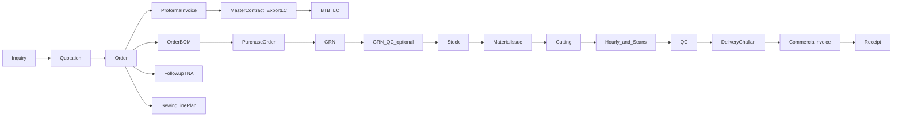

# 02 - Current workflow and gaps

## 1. The workflow as the code runs it today

`orders.pipeline_status` is advanced automatically by `orders/pipeline_service.auto_advance_order_pipeline`
through INQUIRY, QUOTATION, ORDER_CONFIRMED, PI_ISSUED, LC_RECEIVED, BOM_CREATED, PO_ISSUED, RM_RECEIVED,
IN_PRODUCTION, SHIPPED, PAYMENT_RECEIVED, COMPLETED.

## 2. Is the workflow sufficient?

The linear chain is a good commercial backbone but is **not sufficient** for garment manufacturing because:

- Technical approvals (tech pack, fit, size set, PP sample, lab dips, trims, fabric test, PP meeting) run
  **in parallel** with procurement and gate cutting, not after GRN.
- Upstream fabric processes (yarn, knitting, dyeing, finishing, testing) have their own capacity and lead time.
- Line allocation should happen **before** materials arrive (soft) and be firmed when gates pass.
- Shipment booking and export documents run in parallel with finishing.
- Different products, buyers and sourcing routes need different steps.

The target workflow is in `03-target-business-workflow.md`.

## 3. Duplicated functionality

| Domain | Canonical | Duplicate(s) | Risk |
|---|---|---|---|
| BOM | Order BOM (`Bom.order_id`) | Style/classic BOM, consumption plans | Readiness, promise and consumption read the style BOM |
| Material issue | Production Material Issue | Consumption control, manufacturing issue, process order/IDT | No shared issue cap |
| MRP / shortage | Inventory MRP | Manufacturing MRP, readiness, promise, consumption, governed AI detector | Six formulas |
| Production execution | Garment production | Discrete manufacturing | Progress split |
| TNA | Merch follow-up actions | Manufacturing TNA, simple follow-ups | Alert `order_missing_tna` checks the manufacturing one |
| Samples | Merch samples | Manufacturing samples | Only merch links to TNA |
| Export tracking | Trade case | Export case | Two headers |
| Shop-floor QC | Production QC checks | Manufacturing QC | Separate defect data |
| Dashboards / briefs | Governed AI owner brief | Three dashboard AI brief endpoints | Overlap |

## 4. Disconnected workflows

1. Line reservation propose / confirm / release, plan-board assign and material-delay replan exist in the API
   client (`frontend/src/api/production.ts`) but no screen calls them.
2. Hourly entry cannot pick order or line plan, so `sewing_line_style_configs.completed_qty` is never updated.
3. Supplier portal promised ship date does not update `PurchaseOrder.expected_date`.
4. GRN QC pass does not refresh PO status or order RM %.
5. NCR / CAPA do not copy `order_id`, so the "open CAPA blocks challan" gate never fires.
6. Purchase requisition / comparative statement has no link to orders or BOMs.
7. Inquiry and quotation demand is invisible to capacity and MRP.
8. CM actuals and crew attendance sync run only when a user presses a button.

## 5. Defect list

### 5.1 Safe correctness fixes (change displayed numbers only; shown beside legacy under `planning_math_v2`)

| # | Defect | Evidence |
|---|---|---|
| D1 | SMV per piece divided by order quantity | `production/line_reservation_service.py:117` |
| D2 | Capacity = machines x operators x minutes x days | `production/planning_advisory_service.py:91` |
| D3 | Multi-shift minutes averaged, not summed | `planning_advisory_service.py:70-71` |
| D4 | "Load %" is completion % | `manufacturing/planning_router.py:431` |
| D5 | Heatmap puts all minutes on start date | `control_tower/service.py:164-173` |
| D6 | Plan-board assign leaves SMV empty | `production/planning_router.py` `assign_style` |
| D7 | Fixed 480-minute / SMV 12 / 65 % fallbacks | `suggest_service.py`, `hourly_router.py` |
| D8 | Replan shifts calendar days, not working days | `production/replan_service.py:37-41` |

Phase 1 implements corrected versions of D1-D5 and D7 **inside the new read-only module**; the existing code
paths are not changed.

### 5.2 Behaviour changes that need owner approval

| # | Change | Evidence |
|---|---|---|
| B1 | Readiness / promise / consumption read the Order BOM | `readiness_service.py:174` |
| B2 | Start writing stock reservations | `stock_reservations` has no writers |
| B3 | Peg inbound PO supply to orders | `stock_availability_service.py:111-161` |
| B4 | MRP open supply = net of receipts, exclude fully received | `mrp_engine_service.py:204-226` |
| B5 | RM_RECEIVED only when quantity / QC threshold met (not any GRN) | `orders/pipeline_service.py:330` |
| B6 | Crew attendance from dated employee-line assignments | `crew_router.py:1366-1382` |
| B7 | Cost-centre dashboard posted + base currency only | `finance/router.py:4426` |
| B8 | CM recalculation currency and payroll period | `cm_recalc_service.py` |
| B9 | NCR / CAPA carry `order_id` | `manufacturing/quality_router.py` |
| B10 | GRN QC refreshes PO and order status; HOLD re-inspection | `grn_qc_service.py` |
| B11 | PO expected date populated and supplier ETA accepted | `bom_procurement_service.py` |
| B12 | Shared issue cap across four issue paths | `inventory/router.py` |
| B13 | Inquiry / quotation demand with stored probabilities | `merch/routers/pipeline.py:30-43` |
| B14 | Booking and replan actions exposed in UI | `frontend/src/api/production.ts` |

`NEW -> CONFIRMED` order transition: **not changed**. The owner decided that confirmed demand means legacy
status NEW, CONFIRMED or IN_PROGRESS.

## 6. Data relationships that are missing

- No SMV on `garment_styles`, `inquiries` or `orders`.
- No employee to sewing line link; no machine to line link; downtime without machine / line.
- No per-line required date on BOM items; PO expected date often NULL; no numeric vendor lead time.
- No ex-factory / shipment dates beyond `Order.delivery_date` (owner: this field **is** the ex-factory date).
- No colour / size on BOM items, GRN lines, batches or issues; no shade or roll inventory.
