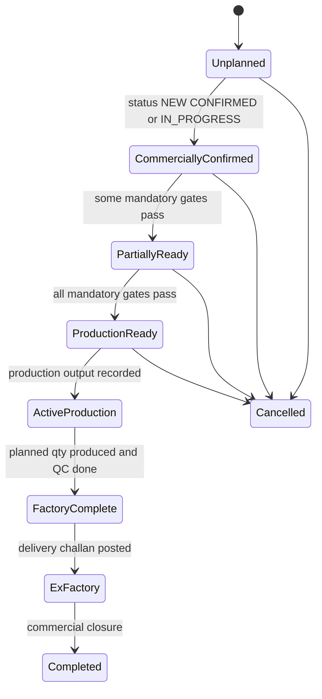

# 03 - Target business workflow

## 1. Principles

- **Style** stays the master reference for merchandising and production. **Order** is the execution source.
- **Export LC / Master Sales Contract** stays primary for finance and commercial and owns the cost centre.
- The chain PI -> orders, MSC/LC -> PI, BTB -> MSC stays as today (nullable links; no new enforcement).
- Not every order follows one rigid sequence. Steps come from a **route** chosen by product type, buyer,
  sourcing mode and manufacturing route, and run in **parallel tracks** with explicit dependencies.
- Gates are either **mandatory** (block production readiness) or **informational** (progress only).

## 2. Parallel tracks

| Track | Typical steps | Owner |
|---|---|---|
| Commercial | Order confirmation, PI, Export LC / sales contract, BTB LC | Merchandising / Commercial |
| Technical | Tech pack receipt, proto / fit sample, size set, PP sample, PP meeting, approved OB / SMV | Merchandising / IE |
| Material | Lab dips, shade approval, trims approval, yarn booking, knitting, dyeing, fabric test (shrinkage, GSM), accessories in-house | Merchandising / Procurement / Store |
| Production | Line allocation, cutting approval, cutting, sewing, inline QC, finishing, packing | Planning / Production |
| Quality | Inline QC, final inspection (AQL), CAPA closure | Quality |
| Logistics | Shipment booking, export documents, ex-factory | Commercial / Logistics |
| Finance | Funding for materials, BTB milestones, payroll coverage | Finance |

## 3. Configurable routes (reuse first)

Phase 2 extends the existing **follow-up action templates** (`followup_action_templates`, already holding
buyer, phase, sequence, delivery offset and mandatory flag) instead of creating new route tables:

- nullable columns: product type, sourcing mode, route code, gate class (mandatory / informational),
  predecessor step keys, working-day lag, evidence type, partial-completion allowed;
- `order_followup_actions` gains nullable provenance (`route_code`, template version).

Examples of routes:
- **Knit basic, in-house fabric:** yarn booking -> knitting -> dyeing -> fabric test -> cutting; technical
  track in parallel; PP meeting gates cutting.
- **Woven, imported fabric (BTB LC):** BTB LC -> supplier ETA -> GRN -> fabric inspection -> cutting.
- **Washed denim:** sewing -> washing (external) -> finishing; washing lead time added to delivery prediction.
- **Repeat style:** fit / size-set approvals marked not applicable when an approved OB exists.

## 4. Readiness dimensions

Each order (and in Phase 2 each colour / size / lot slice) returns six independent dimensions:

| Dimension | Phase 1 evidence (read-only) |
|---|---|
| Commercially confirmed | Legacy `Order.status` in NEW, CONFIRMED, IN_PROGRESS |
| Technically approved | Merch TNA approval milestones (lab dip, fit, PP, bulk fabric) and approved samples |
| Materials ready | Order BOM requirement vs existing availability (no reservations yet) |
| Capacity allocated | Firm / in-progress line plan rows for the order |
| Financially supported | Not evaluated in Phase 1 (`NOT_EVALUATED`) |
| Fully ready | All applicable mandatory dimensions READY |

Each dimension is `READY`, `PARTIAL`, `BLOCKED`, `UNKNOWN`, `NOT_APPLICABLE` or `NOT_EVALUATED`.
Mandatory blockers are listed separately from informational progress. A Style-BOM-only order can never be
"fully ready" (its material result is labelled `STYLE_ESTIMATE`).

## 5. Order planning state transitions

This planning state is **calculated**, never stored over the existing `status` or `pipeline_status`.

## 6. Dates

- `Order.delivery_date` = **ex-factory date** (owner decision, 2026-11-12). Delivery prediction compares the
  predicted ex-factory date against it.
- Later (Phase 2, if approved): optional target shipment date and buyer delivery date fields, keeping
  `delivery_date` unchanged.

## 7. Approval gates kept as today

Quotation approval, commercial lock / change requests, BOM submit / approve / freeze, PO approval, GRN QC,
challan approval, voucher posting and period locks are untouched. Manufacturing Intelligence never bypasses them.
