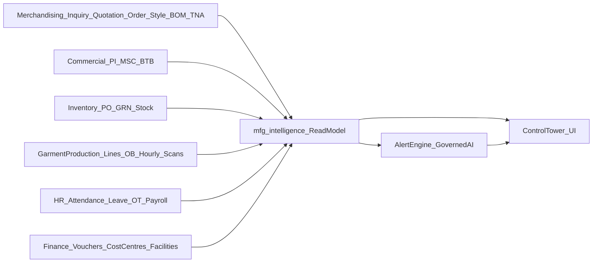
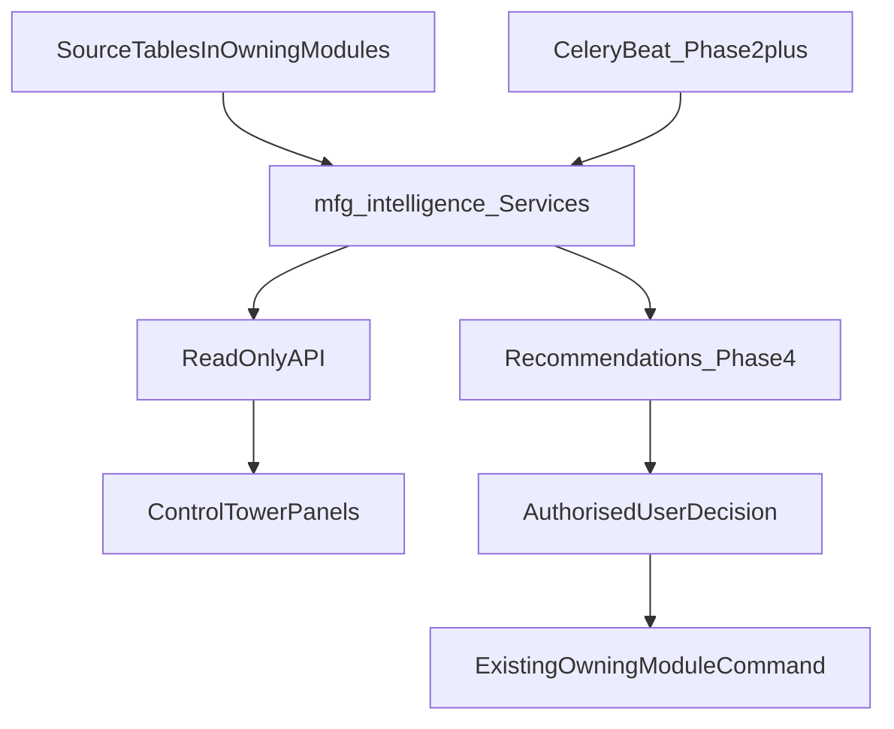

# 06 - Cross-module integration

## 1. Module dependency diagram

`mfg_intelligence` **reads** from the owning modules and owns no transactional writes. Any later action
(booking, allocation, revision) is executed by the owning module's existing command after an authorised
human confirms.

## 2. Data flow

Phase 1: on-demand calculation only (no cache table, no worker). Phase 2+: Celery beat recompute and
permission-scoped Redis cache (keyed by tenant, permission scope and filters). No Kafka, no outbox table
unless measured need appears (Phase 5).

## 3. What each department sees

| Department | Sees | Phase |
|---|---|---|
| Marketing | Future firm / potential capacity by month; feasible ex-factory windows; pipeline demand | 1 (capacity), 2 (pipeline) |
| Merchandising | Order readiness, blockers, TNA milestones, BOM status, delivery risk | 1 |
| Procurement | Material shortages per order, required dates, critical POs, supplier ETA risk | 1 (shortage), 2 (ETA) |
| Production | Line loading, overloaded / idle days, ready orders, daily capacity | 1 |
| HR | Planned manpower demand per line, skill shortages, OT forecast | 2 |
| Finance | Procurement payments, BTB, payroll, working-capital gap, cost to complete | 3 |
| Management | All of the above in the Control Tower | 1 onward |

## 4. Change propagation (how one department's change reaches others)

| Change | Today | Target |
|---|---|---|
| Order quantity / ex-factory date amended | Order row updated | Next read recalculates load, readiness and delivery risk (P1); P2 re-allocates delta |
| BOM approved / frozen | `auto_advance_order_pipeline` | Readiness picks up Order BOM (P1 flag) |
| PO expected date / supplier ETA | Not fed back | ETA chain recalculates readiness date (P2) |
| GRN accepted | Stock movement, TNA sync | Availability rises; readiness recalculates (P1 read) |
| Line plan moved | Row updated | Line loading and delivery prediction recalculate (P1); revision ledger (P2) |
| Attendance captured | Attendance entries | Same-day operator minutes (P2 with assignments) |
| Voucher posted | Ledger | Cost-to-complete and cash need (P3) |

Synchronous hooks that already exist (`auto_advance_order_pipeline`, `maybe_sync_followup`) are **not** called by
`mfg_intelligence` because they write.

## 5. Cross-module alerts and approvals (Phase 4)

Bottleneck findings become `alert_instance` rows through the existing alert engine (natural-key dedupe,
assignment, escalation). Recommendations reuse governed AI human confirmation (`ai.agents.confirm`) and the
`ai_agent_decisions` table (extended with nullable recommendation / outcome fields). Nothing changes a schedule,
PO, payroll, financing or shipment without an authorised user.
