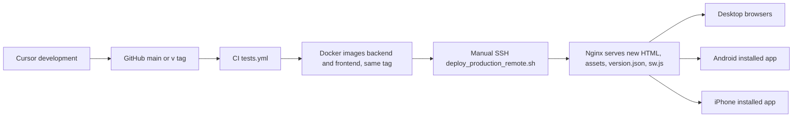
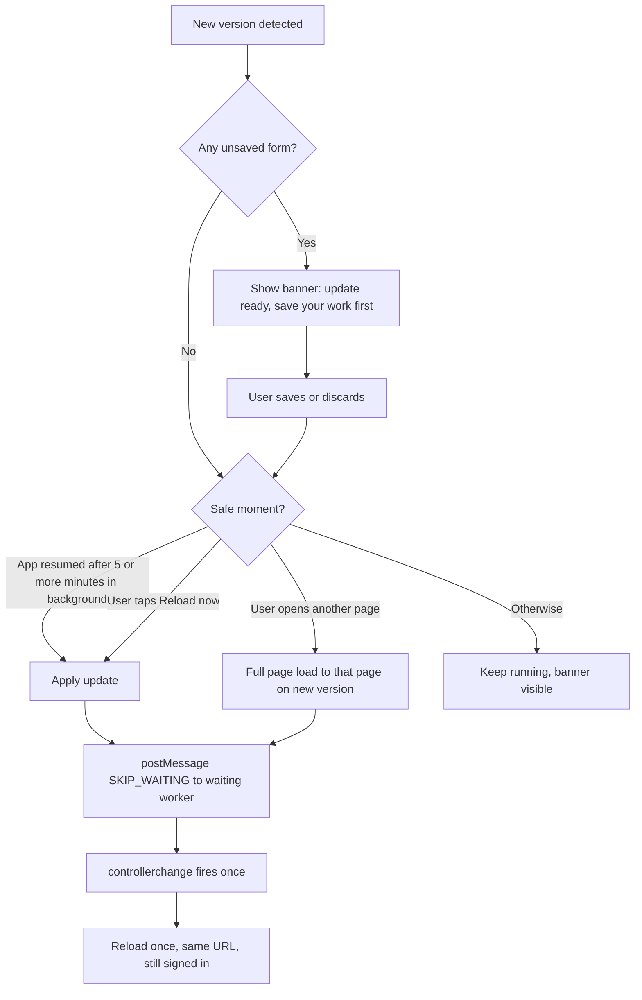

# Automatic update strategy

**Status:** implemented 2026-11-11 behind the build switch `VITE_PWA_ENABLED` (default off), not yet deployed. Code:
`frontend/public/sw.js`, `frontend/src/lib/pwa/appUpdate.ts`, `frontend/src/lib/pwa/installPrompt.ts`,
`frontend/src/components/shell/AppUpdateBanner.tsx`, `p7MobileAppPlugin` in `frontend/vite.config.ts`, kill switch
`frontend/pwa/sw-kill-switch.js`. Test guide: `LOCAL-AND-PHONE-TEST-GUIDE.md`. Two deliberate differences from the first
design are marked "Implemented:" below. Service-worker behaviour comes from web.dev
(Google) documentation, accessed 2026-11-08 to 2026-11-10 (sources at the end). Repository facts come from
`EXISTING-ERP-AUDIT.md`.

**Goal:** after every production web deploy, every phone running the installed Prime7 app runs the new version **without
reinstalling**, ideally when the app is reopened, and **never loses unsaved ERP data** in the process.

**Honest wording:** the **detection and download** of a new version can be fully automatic. **Switching** a running app to
the new version may wait for a safe moment (no unsaved form) or, in rare cases, for the user. Browsers and Apple publish no
guaranteed timing, so the numbers below are **targets to be measured** in the proof of concept, not promises.

---

## 1. The pipeline stays the same

There is **no separate mobile build, store or release**. The frontend image that serves the website also serves the
installed app. What changes is a few small files and rules inside that image (section 9).

## 2. Design principle: the server decides the version, the service worker stays small

There are two common designs:

| Design | How the app version is chosen | Good | Bad |
|---|---|---|---|
| **1. Full precache** ("app shell" served from the service worker) | The service worker stores every file of one release, including `index.html`; the app changes version only when a new worker activates | Works offline from a cold start; old open apps always have their own files | Service worker becomes the version authority; a bug can pin users on an old version; first install downloads the whole app (local build: 531 files, 6.7 MB uncompressed); clashes with the SEO route shells |
| **2. Network-first HTML + small worker** (recommended) | Every launch fetches fresh `index.html` from the server (never cached); the worker only caches immutable hashed files it has seen and shows an offline page | Same version logic as today's website; a cold start always gets the newest release; small downloads; a broken worker can be removed without stranding users | No offline cold start (acceptable: ERP data needs the network anyway) |

**Recommendation: Design 2.** It keeps Prime7's existing, working model (fresh HTML, immutable hashed assets, stale-chunk
recovery) and adds only what an installed app needs. Full precaching can be reconsidered only if offline app start becomes
a business requirement.

## 3. The pieces

### 3.1 Files and cache rules

| File | Cache rule (Nginx) | Purpose |
|---|---|---|
| Every HTML response (`/index.html`, generated `/<route>/index.html`, SPA fallback) | `Cache-Control: no-store` | A launch always sees the newest release. Today only exact `/index.html` has this (`frontend/nginx.prod.conf:57-64`). |
| `/assets/*` (hashed JS/CSS) | `public, max-age=31536000, immutable` (unchanged) | Content-addressed, safe to cache forever |
| `/sw.js` (fixed name, never hashed) | `no-cache` | The browser byte-compares it on every check. Changing its URL would break updates. |
| `/manifest.webmanifest` | `no-cache` | Name, icons, colours, `start_url` |
| `/version.json` | `no-store` | `{"version": "v1.9.0", "built_at": "..."}` written at image build from `VITE_APP_VERSION` |
| `/offline.html` | `no-cache` | Static page shown when there is no network; no ERP data |
| `/api/*`, `/media/*`, `/health`, `/iclock/*` | Never handled by the service worker | Authenticated or device data must never enter Cache Storage |

The host Nginx (not in the repository) must not cache or rewrite these files either. **[UNVERIFIED]** until checked on the
server.

### 3.2 What the service worker does (and does not do)

- `install`: cache `offline.html` and the app icons. Nothing else.
- `fetch`:
  - Navigation requests: go to the network. Only if the network fails, answer with `offline.html`.
  - `/assets/*`: cache-first in a runtime cache (files are immutable). Old entries are deleted on `activate` after a
    size/age limit.
  - Everything else, especially `/api/`, `/media/`, `/health`, `/iclock/`, `/portal` API calls, blobs, PDFs and any request
    carrying `Authorization`: **not touched** (browser default network handling).
- `message`: on `{type: "SKIP_WAITING"}` call `self.skipWaiting()`. The worker never calls `skipWaiting()` on its own.
- `activate`: `clients.claim()` and delete caches from older worker versions.
- **Implemented:** `sw.js` does **not** change with every release; it changes only when its caching rules change
  (`CACHE_VERSION`). Because HTML is network-first, a release is detected through `version.json`, and switching is a plain
  reload; the `SKIP_WAITING` path is used only in the rare release that also ships a new worker.

### 3.3 Keeping old open apps working (asset continuity)

Problem: a user opened a voucher form on version N and left it open. We deploy N+1. Hashed chunks of N are no longer in the
new image, and Nginx returns 404 for them (`nginx.prod.conf:45-47`). If the user now opens a page they had not visited, its
chunk is missing.

Options evaluated:

| Option | How | Assessment |
|---|---|---|
| a. Full precache in the worker | Old worker holds all of N | Rejected with Design 1 (above) |
| b. **Keep previous release assets on the server** (recommended) | The frontend image build copies the `/assets/` files listed by the previous release into the new image (multi-stage `COPY --from=<previous frontend image>`), so N and N-1 files are both served | Helps every user (website and installed app), no service-worker dependency, small images. Needs the previous tag as a build argument and a per-release asset list so files do not pile up forever |
| c. Shared host volume for assets | Assets accumulate on the server disk | Rejected: breaks the immutable image model and the rollback-by-tag model |

**Implemented (option b):** `frontend/Dockerfile.prod` copies only plain file names directly under `assets/` with known
asset extensions from the previous image (nothing with `..`, no sub-folders, no `.html`), and the workflows take the
previous image only from the last released `v*` tag, pinned by digest (never `:latest`). Checked with planted bad entries
on 2026-11-11.

With option b, an app left open across **one** deploy keeps working. If it stays open across **two or more** deploys and
then loads a page it never visited, the chunk can still be missing; section 4 explains how that case is handled without
losing the form.

### 3.4 Knowing that a new version exists

The app checks for a new version:

- at every launch (fresh `index.html` already brings the new version; nothing else needed);
- when the app becomes visible again (`visibilitychange`), for example after the user switches back to it;
- when the network comes back (`online`);
- every 10 minutes while the app stays in the foreground.

Each check does two cheap things: `registration.update()` (re-fetches `sw.js`) and `fetch("/version.json", {cache:
"no-store"})`. A new version is detected when `version.json` **differs** from the running `VITE_APP_VERSION` (not "is
greater than", so a rollback is also picked up). Failures (offline, timeouts) are ignored silently; the app keeps running.

### 3.5 Switching to the new version safely

Rules:

1. **Never** reload, skip waiting or navigate while the app-wide unsaved-changes registry reports a dirty form.
2. A "safe moment" is: the app was in the background for at least 5 minutes and comes back with no dirty form; or the user
   follows an in-app link (the app does a full page load to the target URL instead of a client-side route change); or the
   user taps **Reload now**.
3. `controllerchange` triggers **one** reload, guarded by a flag so it can never loop.
4. The reload keeps the current URL. The session (`localStorage` token) is untouched, so the user stays signed in.
5. The banner is a non-blocking strip (not a modal), so it never covers a Save button.

### 3.6 App-wide unsaved-changes registry (prerequisite)

Today only the HR employee workspace has a guard (`frontend/src/components/hr/workspace/useUnsavedChangesGuard.ts`), and
nothing app-wide knows whether a form is dirty. Plan:

- Move the guard to a shared place (for example `frontend/src/lib/unsavedChanges.ts` plus the hook) and keep its
  `BrowserRouter`-compatible behaviour (`beforeunload`, capture-phase link clicks, Back button).
- Each mounted guard registers itself in a small registry (`isAnyFormDirty()`), used by the update flow **and** by the
  stale-chunk recovery.
- Change `frontend/src/lib/chunkReload.ts` so that a chunk error while a form is dirty shows the banner ("This page needs
  the new version. Save your work, then tap Reload.") instead of reloading. Today it reloads at once
  (`chunkReload.ts:54-63`), which can drop typed data even without a PWA.
- Adopt the guard first on high-value entry screens: vouchers, GRN, purchase orders, orders, BOM, payroll, HR forms,
  quotations.

### 3.7 Frontend and backend compatibility

- Backend and frontend images are built from the same commit and tag (`.github/workflows/deploy.yml:46-70`).
- During a deploy and for one release afterwards, the backend must accept requests from the **current and previous**
  frontend. The existing rule "additive, backwards-compatible API changes only" (`.cursor/rules/live-server-stability.mdc`)
  already provides this; it becomes mandatory with installed apps because an app may stay open for hours.
- Optional later safeguard (needs approval, new env var with a safe default): the frontend sends
  `X-P7-Client-Version`; if the backend is configured with `MIN_FRONTEND_VERSION` and the client is older, it answers
  `426` with code `client_outdated`; the frontend shows the update banner **and keeps the form on screen**. Off by default.
- Deploy check (to add to `scripts/deploy_production_remote.sh`): after `up -d`, confirm `/health` `version` and
  `/version.json` `version` both equal the requested tag.

### 3.8 Rollback

- **Normal rollback:** run the deploy script with the previous tag for both images (a compatible pair). Installed apps see
  `version.json` differ from their running version and switch back at the next safe moment, exactly like an update.
- **Database:** rollback is only as safe as the migrations. Prime7 migrations are phased and backward-compatible
  (`.cursor/rules/live-server-stability.mdc`), which is what allows an older backend to run on a newer schema.
- **Implemented, switching off:** a build with `VITE_PWA_ENABLED=false` makes the app unregister any service worker it
  finds (`startMobileApp` in `appUpdate.ts`). This is the normal "off" path.
- **Broken service worker (kill switch):** keep a ready "self-destroying" `sw.js` in the repository. It deletes its caches,
  calls `self.registration.unregister()` and reloads controlled pages. Deploying it returns every device to plain website
  behaviour within one check. Because HTML is never cached, users are never stuck on an old app while it propagates.
- **Script hardening (recommended):** save the previous `BACKEND_IMAGE` / `FRONTEND_IMAGE` values before editing `.env`,
  and restore them automatically if the health/version check fails (today the script only exits;
  `scripts/deploy_production_remote.sh:31-62`).
- **Implemented:** the script saves the previous release in `.env.previous-release`, checks after start-up that the
  backend `/health` version **and** the frontend `/version.json` equal the requested tag, and on failure prints the exact
  rollback command. It does **not** roll back by itself: the backend runs `alembic upgrade head` when it starts, so the
  database may already be migrated, and an older backend can fail to start on a newer schema. A person decides.

### 3.9 Registration scope and install prompt capture

- The worker is registered from the shared entry point (`frontend/src/main.tsx`) with scope `/`, so the landing page, the
  login page, the staff app and the portals all belong to one installable app. Because navigations are network-first, the
  generated SEO route shells (`frontend/scripts/inject-static-route-html.ts`) keep working unchanged.
- The manifest uses `start_url: "/app"` and `display: "standalone"`. A signed-out user is sent to `/login` by the existing
  `ProtectedRoute` (`frontend/src/app/router.tsx:211-216`); a signed-in user lands on the dashboard. Portal users start at
  `/app` too and are sent to login, where they pick their portal role; a portal-specific start URL can be added later.
- The same module listens for `beforeinstallprompt` (Chrome, Edge, Samsung Internet on Android), calls
  `event.preventDefault()`, and keeps the event so the "Install the app" page can call `prompt()` later after a user tap.
  It also listens for `appinstalled` and checks `matchMedia("(display-mode: standalone)")` (plus `navigator.standalone` on
  iOS) so the install shortcut can be hidden when the app is already installed.
- Safari on iOS never fires `beforeinstallprompt`; the install page shows manual steps instead
  (`RECOMMENDED-IMPLEMENTATION-PLAN.md`, install entry points).

## 4. Offline and poor network

| Situation | Behaviour |
|---|---|
| App opened with no network | `offline.html`: "You are offline. Prime7 needs a connection." No ERP data shown. |
| Network drops while a form is open | The form stays on screen. Save shows an error; the user can try again. No automatic queue for general ERP writes. |
| Slow request | Planned: a request timeout (for example 30 seconds) in `frontend/src/api/core.ts` with a clear message; today requests have no timeout |
| Version check fails | Ignored; retried at the next trigger |
| Production scan station | Keeps its existing local queue with unique `client_key` (`scanQueue.ts`); not generalised |
| Back online | Next check picks up any new version |

**Why no general offline writes:** vouchers, stock movements and payroll need server-side period checks, approvals,
locking and idempotency. Queuing them on a phone would bypass these controls. This stays out of scope.

## 5. How fast users get updates (targets to measure)

| Situation | Expected result | Target (measure in POC) | Manual action? |
|---|---|---|---|
| App closed, then opened after the deploy | New version on that launch | 100% of trials | No |
| App in background, then resumed (no dirty form) | Detected on resume; applied automatically if it was hidden 5+ minutes | Applied within 30 s of resume in at least 9 of 10 trials per device (POC test P9) | No |
| App in foreground, user browsing | Detected within 10 minutes; applied at the next page change | Within 10 min + next navigation | No |
| App in foreground with a dirty form | Banner only; applied after save/discard | No reload until clean, 100% of trials | User saves |
| Device offline during deploy | Updated after the network returns | First check after reconnect | No |
| App left open across two or more deploys with a dirty form, opening an unvisited page | Banner asks to save then reload; form stays | No data loss, 100% | User saves, taps Reload |
| Icon / name / colour change | Android: when Chrome re-checks the manifest (about every 24 h after a launch). iOS: icon is captured when added (verify in POC) | Android within 48 h | iOS: possibly re-add |
| Optional TWA shell change | New APK | — | Install APK |
| iOS deleted the app's storage (long unused) | Next launch is a fresh start | — | Sign in again |

## 6. Updating while users are logged in

- Update reloads keep `localStorage`, so the session survives. The 60-minute token expiry is unrelated to updates.
- Query cache is in memory and is rebuilt after the reload (`frontend/src/lib/queryClient.ts`).
- Single-session enforcement (`session_superseded`) is unchanged.
- If the session expires while a form is dirty, today the app redirects to login and the form is lost
  (`handleSessionExpiredUnauthorized`, `frontend/src/api/core.ts:46-60`). The security plan (refresh / longer mobile session)
  and the unsaved-changes registry should be used together so expiry never silently drops a form; this is listed as a
  prerequisite in `RECOMMENDED-IMPLEMENTATION-PLAN.md`.

## 7. Situations that need a person

1. A dirty form when an update is ready: the user saves or discards, then the update applies.
2. Two or more deploys while a page is left open and an unvisited page is opened: save, then tap Reload.
3. iOS icon change (if confirmed by the POC): re-add to home screen.
4. Optional TWA APK shell change: install the new APK.
5. A broken service worker: engineering deploys the kill switch; users do nothing.

## 8. Testing the strategy

Automated (later, in CI): unit tests for version comparison, the dirty registry, the single-reload guard and the
chunk-error path; a build check that `sw.js` never caches `/api/`, `/media/` or requests with `Authorization`; an image test
that checks the cache headers in section 3.1. Manual on devices: the proof of concept in
`RECOMMENDED-IMPLEMENTATION-PLAN.md`.

## 9. Repository changes this strategy will need later (not done now)

| Area | Change |
|---|---|
| `frontend/public/` | `manifest.webmanifest`, icons (192, 512, maskable, apple-touch), `offline.html`, `sw.js`, kill-switch `sw.js` kept separately |
| `frontend/index.html` | `<link rel="manifest">`, `apple-touch-icon`, Apple web-app meta tags |
| `frontend/src/` | service-worker registration + update hook, update banner, shared unsaved-changes registry, `chunkReload.ts` change, request timeout, install page / modal |
| `frontend/nginx.prod.conf` | `no-store` for all HTML; `no-cache` for `sw.js` and manifest; `no-store` for `version.json`; `no-store` for `/api/` and `/media/` (security doc) |
| `frontend/Dockerfile.prod` | write `version.json`; copy previous release assets (build argument with the previous image tag) |
| `.github/workflows/deploy.yml` | pass the previous frontend tag as a build argument; optional image smoke test for headers |
| `scripts/deploy_production_remote.sh` | version check after deploy; automatic restore of previous tags on failure |
| Backend | none required; optional `MIN_FRONTEND_VERSION` check later |

No database migration, no new required environment variable, no change to ports, volumes or service names.

## 10. Official sources (accessed 2026-11-08 to 2026-11-10)

- web.dev (Google), "The service worker lifecycle" — https://web.dev/articles/service-worker-lifecycle (waiting state,
  `skipWaiting`, update triggers, byte comparison, 24-hour check for functional events)
- web.dev (Google), "Update" (Learn PWA) — https://web.dev/learn/pwa/update (detecting a waiting worker,
  `controllerchange`, caution about `skipWaiting`)
- web.dev (Google), "Service workers" (Learn PWA) — https://web.dev/learn/pwa/service-workers (keep the worker file name
  stable; refresh alone does not activate a waiting worker)
- web.dev (Google), "Service worker mindset" — https://web.dev/articles/service-worker-mindset
- web.dev (Google), "How Chrome handles updates to the web app manifest" — https://web.dev/articles/manifest-updates
- web.dev (Google), "The offline cookbook" — https://web.dev/articles/offline-cookbook
